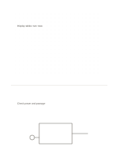

# Dot field and open field

`dot-and-blank` · `hybrid` · `a5-draft`

[繁體中文](README.zh-TW.md) · [English](README.en.md) · [日本語](README.ja.md) · [Back to catalog](../../docs/en/catalog.md)

Use dots for spatial planning above and leave an open area below for free notes.

## When to use it

- Sketch display-table positions and list materials to check.
- Keep a plot of data points beside reflection notes.

## How to use it

1. Arrange positions or rough proportions in the dot field.
2. Use the open field for observations, questions, and next actions.
3. Connect notes back to a location in the sketch when useful.

## What the page helps you see

A drawing, short notes, and a conclusion kept separate but connected.

## Worked example

A fictional display uses four table positions above and notes below that outlet and path width need checking.

[SVG](examples/en.svg)

## When not to use it

Dots are not a calibrated ruler; do not use this as a construction plan without measured dimensions.

## Downloads

- [Wordless SVG](exports/a5-draft/blank.svg)
- [Wordless PDF](exports/a5-draft/blank.pdf)
- [PDF with English name at top left](exports/a5-draft/titled.pdf)
- [Darker-ink wordless PDF](exports/a5-contrast/blank.pdf)
- [Darker-ink SVG](exports/a5-contrast/blank.svg)

The English name appears only on the titled PDF; the wordless version remains available for free writing.

Page size: A5 (148 × 210 mm); profile: `a5-draft`.

## Provenance and status

Original layout · Detailed source record: [manifest.json](manifest.json)  
[MIT license scope](../../LICENSE-SCOPE.md)

[Trilingual glossary](../../docs/en/glossary.md)

## Modify and rebuild

Change `profiles/a5-draft.json` or the corresponding builder in `src/noteformats/layouts/`, then run from the project root:

`python scripts/build.py --ids dot-and-blank`
