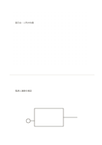

# 上はドット、下は余白

`dot-and-blank` · `hybrid` · `a5-draft`

[繁體中文](README.zh-TW.md) · [English](README.en.md) · [日本語](README.ja.md) · [一覧へ戻る](../../docs/ja/catalog.md)

上の点で位置関係を描き、下の余白に自由な補足を書きます。

## 向いている場面

- 展示台の配置を描き、材料の確認点を記すとき。
- 点の草図と感想を分けるとき。

## 使い方

1. 上の点の領域で位置や大まかな比率を描きます。
2. 下の余白に観察、疑問、次の行動を書きます。
3. 必要なら文章と図の位置を線で結びます。

## 記入後に見えること

図、短い記録、結論を分けながら関係づけられます。

## 記入例

架空の展示台四台の位置を上に示し、下に電源と通路幅の確認点を書きます。

[SVG](examples/ja.svg)

## 向いていない場面

ドットは校正された定規ではありません。実測寸法なしに施工図として使わないでください。

## ダウンロード

- [文字なしSVG](exports/a5-draft/blank.svg)
- [文字なしPDF](exports/a5-draft/blank.pdf)
- [左上に英語名があるPDF](exports/a5-draft/titled.pdf)
- [濃い線の文字なしPDF](exports/a5-contrast/blank.pdf)
- [濃い線のSVG](exports/a5-contrast/blank.svg)

英語名は表題付きPDFだけに印刷され、文字なし版は自由な記入に使えます。

用紙サイズ：A5（148 × 210 mm）。設定ファイル：`a5-draft`。

## 由来と状態

本プロジェクトの独自レイアウト · 詳しい由来の記録： [manifest.json](manifest.json)  
[MITライセンスの範囲](../../LICENSE-SCOPE.md)

[三言語の用語集](../../docs/ja/glossary.md)

## 変更と再生成

`profiles/a5-draft.json` または `src/noteformats/layouts/` の描画関数を変更し、プロジェクトのルートで実行します：

`python scripts/build.py --ids dot-and-blank`
