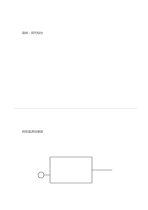

# 上點陣下留白

`dot-and-blank` · `hybrid` · `a5-draft`

[繁體中文](README.zh-TW.md) · [English](README.en.md) · [日本語](README.ja.md) · [返回目錄](../../docs/zh-TW/catalog.md)

先用點陣安排位置或比例，再在留白區寫自由補充。

## 適合情境

- 畫小型展桌配置後記下待確認的材料。
- 將資料點位草圖與心得分開記錄。

## 使用步驟

1. 在上方點陣區畫位置關係或簡單比例。
2. 下方留白寫觀察、疑問與下一步。
3. 檢查文字是否真的對應圖中某個位置，必要時加連線。

## 整理後可得到

把圖、短記與結論放在各自區域，再檢查關係。

## 實際填寫示例

虛構展桌在上方以四個位置點排出草圖，下方記『電源位置與通道寬度待查』。

[SVG](examples/zh-TW.svg)

## 不適合情境

點陣不是精確尺規，沒有核定尺寸時不能當施工圖。

## 下載

- [無字 SVG](exports/a5-draft/blank.svg)
- [無字 PDF](exports/a5-draft/blank.pdf)
- [左上角英文名稱 PDF](exports/a5-draft/titled.pdf)
- [深色墨線無字 PDF](exports/a5-contrast/blank.pdf)
- [深色墨線 SVG](exports/a5-contrast/blank.svg)

英文名稱只印在標題版 PDF；無字版仍適合自由列印與改作。

頁面尺寸：A5（148 × 210 mm）；設定檔：`a5-draft`。

## 來源與狀態

本專案原創版面 · 詳細來源紀錄見 [manifest.json](manifest.json)  
[MIT 授權範圍](../../LICENSE-SCOPE.md)

[三語術語表](../../docs/zh-TW/glossary.md)

## 修改與重新生成

修改 `profiles/a5-draft.json` 或 `src/noteformats/layouts/` 內對應的繪圖函式，再於專案根目錄執行：

`python scripts/build.py --ids dot-and-blank`
