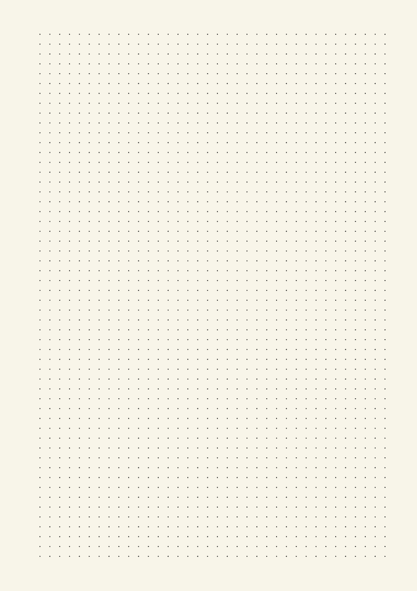
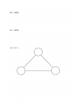

# 細點陣

`dot-fine` · `grid-dot` · `a5-draft`

[繁體中文](README.zh-TW.md) · [English](README.en.md) · [日本語](README.ja.md) · [返回目錄](../../docs/zh-TW/catalog.md)

以淡點輔助對齊，同時保留比方格更開放的書寫感。 本款的幾何變化： 點陣間距: 3.5 mm.

## 適合情境

**幾何對照:** `parameter` · [dot-standard](../dot-standard/README.zh-TW.md)

- 用細點距對齊小型圖示，仍保留手繪曲線的自由。
- 在同頁寫密集短記並加上迷你關係圖，以點位控制間距。

## 使用步驟

1. 把點當作定位參考，不必每個點都用到。
2. 先寫主題，再以點連成需要的框或線。
3. 回看時檢查畫出的結構是否比文字更清楚。

## 整理後可得到

用格線或點位對齊物件、數量與相對位置。

## 實際填寫示例

示例把虛構社區活動的場地、材料與人員畫成三個對齊的短區塊。 示例以虛構資料在對應區域放入短語，示意填寫位置；不是實測或完整研究結論。

[SVG](examples/zh-TW.svg)

## 不適合情境

需要明確格界或連續橫線時，只有點可能不夠醒目。 細小格子只宜短語，不適合長篇段落。

## 下載

- [無字 SVG](exports/a5-draft/blank.svg)
- [無字 PDF](exports/a5-draft/blank.pdf)
- [左上角英文名稱 PDF](exports/a5-draft/titled.pdf)
- [深色墨線無字 PDF](exports/a5-contrast/blank.pdf)
- [深色墨線 SVG](exports/a5-contrast/blank.svg)

英文名稱只印在標題版 PDF；無字版仍適合自由列印與改作。

頁面尺寸：A5（148 × 210 mm）；設定檔：`a5-draft`。

## 來源與狀態

傳統書寫紙改編 · 詳細來源紀錄見 [manifest.json](manifest.json)  
[MIT 授權範圍](../../LICENSE-SCOPE.md)

[三語術語表](../../docs/zh-TW/glossary.md)

## 修改與重新生成

調整 `src/noteformats/variants.py` 的幾何或 `src/noteformats/variant_content.py` 的文字，再於專案根目錄執行：

`python scripts/build.py --ids dot-fine`
