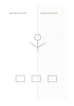

# Dots beside grid

`dot-grid-split` · `grid-dot` · `a5-draft`

[繁體中文](README.zh-TW.md) · [English](README.en.md) · [日本語](README.ja.md) · [Back to catalog](../../docs/en/catalog.md)

Place an open dot field beside a regular square grid on the same page.

## When to use it

- Sketch relationships on the left and align related quantities on the right.
- Compare a free composition with an orderly arrangement.

## How to use it

1. Decide what relationship or outline to explore in the left dot field.
2. Use the right grid for quantities or proportions that need cell alignment.
3. Connect the sides with your own notes, without assuming they share one scale.

## What the page helps you see

Aligned objects, counts, or spatial positions on the grid or dots.

## Worked example

The left side explores plants in a fictional garden; the right aligns the number and placement of pots.

[SVG](examples/en.svg)

## When not to use it

Each side is only half a page wide, limiting long notes or large detailed drawings.

## Downloads

- [Wordless SVG](exports/a5-draft/blank.svg)
- [Wordless PDF](exports/a5-draft/blank.pdf)
- [PDF with English name at top left](exports/a5-draft/titled.pdf)
- [Darker-ink wordless PDF](exports/a5-contrast/blank.pdf)
- [Darker-ink SVG](exports/a5-contrast/blank.svg)

The English name appears only on the titled PDF; the wordless version remains available for free writing.

Page size: A5 (148 × 210 mm); profile: `a5-draft`.

## Provenance and status

Original mixed layout · Detailed source record: [manifest.json](manifest.json)  
[MIT license scope](../../LICENSE-SCOPE.md)

[Trilingual glossary](../../docs/en/glossary.md)

## Modify and rebuild

Change `profiles/a5-draft.json` or the corresponding builder in `src/noteformats/layouts/`, then run from the project root:

`python scripts/build.py --ids dot-grid-split`
