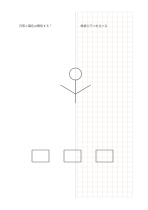

# 左ドット・右方眼

`dot-grid-split` · `grid-dot` · `a5-draft`

[繁體中文](README.zh-TW.md) · [English](README.en.md) · [日本語](README.ja.md) · [一覧へ戻る](../../docs/ja/catalog.md)

自由につなげる点の領域と、整然と並べる方眼を一枚に置きます。

## 向いている場面

- 左に関係図を描き、右に対応する数量を並べるとき。
- 自由な構図と規則的な配置の二案を比べるとき。

## 使い方

1. 左のドット領域で探る関係や輪郭を決めます。
2. 右の方眼ではマスにそろえる数量や比率を整理します。
3. 自分の注記で両側を結びますが、縮尺が同じとは決めつけません。

## 記入後に見えること

方眼や点に沿って物、数、位置をそろえられます。

## 記入例

架空の庭で左に植物の関係、右に鉢の数と配置を記入しています。

[SVG](examples/ja.svg)

## 向いていない場面

各領域は半ページ幅なので、長文や大きな詳細図には狭いものです。

## ダウンロード

- [文字なしSVG](exports/a5-draft/blank.svg)
- [文字なしPDF](exports/a5-draft/blank.pdf)
- [左上に英語名があるPDF](exports/a5-draft/titled.pdf)
- [濃い線の文字なしPDF](exports/a5-contrast/blank.pdf)
- [濃い線のSVG](exports/a5-contrast/blank.svg)

英語名は表題付きPDFだけに印刷され、文字なし版は自由な記入に使えます。

用紙サイズ：A5（148 × 210 mm）。設定ファイル：`a5-draft`。

## 由来と状態

本プロジェクトの独自の複合配置 · 詳しい由来の記録： [manifest.json](manifest.json)  
[MITライセンスの範囲](../../LICENSE-SCOPE.md)

[三言語の用語集](../../docs/ja/glossary.md)

## 変更と再生成

`profiles/a5-draft.json` または `src/noteformats/layouts/` の描画関数を変更し、プロジェクトのルートで実行します：

`python scripts/build.py --ids dot-grid-split`
