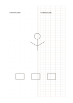

# 左點右格

`dot-grid-split` · `grid-dot` · `a5-draft`

[繁體中文](README.zh-TW.md) · [English](README.en.md) · [日本語](README.ja.md) · [返回目錄](../../docs/zh-TW/catalog.md)

一頁同時保留自由連線的點陣與規整對齊的方格。

## 適合情境

- 左邊畫關係草圖，右邊整理對應的數量。
- 比較自由構圖與規整布局的兩種方案。

## 使用步驟

1. 先決定左邊要探索的關係或輪廓。
2. 右邊把需要逐格對齊的資料或比例另行整理。
3. 用自己的註記連結兩側，但不要假定兩側自動共享比例。

## 整理後可得到

用格線或點位對齊物件、數量與相對位置。

## 實際填寫示例

示例左邊記虛構花園的植物關係，右邊把花盆數量與排列放到格上。

[SVG](examples/zh-TW.svg)

## 不適合情境

每側僅半頁寬；長篇筆記或大型細圖會受限。

## 下載

- [無字 SVG](exports/a5-draft/blank.svg)
- [無字 PDF](exports/a5-draft/blank.pdf)
- [左上角英文名稱 PDF](exports/a5-draft/titled.pdf)
- [深色墨線無字 PDF](exports/a5-contrast/blank.pdf)
- [深色墨線 SVG](exports/a5-contrast/blank.svg)

英文名稱只印在標題版 PDF；無字版仍適合自由列印與改作。

頁面尺寸：A5（148 × 210 mm）；設定檔：`a5-draft`。

## 來源與狀態

本專案原創混合版面 · 詳細來源紀錄見 [manifest.json](manifest.json)  
[MIT 授權範圍](../../LICENSE-SCOPE.md)

[三語術語表](../../docs/zh-TW/glossary.md)

## 修改與重新生成

修改 `profiles/a5-draft.json` 或 `src/noteformats/layouts/` 內對應的繪圖函式，再於專案根目錄執行：

`python scripts/build.py --ids dot-grid-split`
