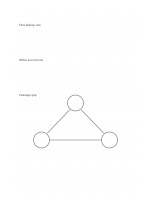

# Staggered dot grid

`dot-staggered` · `grid-dot` · `a5-draft`

[繁體中文](README.zh-TW.md) · [English](README.en.md) · [日本語](README.ja.md) · [Back to catalog](../../docs/en/catalog.md)

Offset alternate rows of dots to guide diagonal and triangular arrangements.

## When to use it

- Sketch objects in hexagonal or triangular patterns.
- Compare straight and staggered seating arrangements.

## How to use it

1. Mark a main direction along one row of dots.
2. Connect points in the next half-offset row to establish diagonals.
3. Check whether the drawing needs an explicit scale and real distances.

## What the page helps you see

Aligned objects, counts, or spatial positions on the grid or dots.

## Worked example

Three display rows in a fictional exhibition are staggered, with an opening left for passage.

[SVG](examples/en.svg)

## When not to use it

Ordinary rectangular tables are harder to align on offset dots. The dots have no certified engineering scale.

## Downloads

- [Wordless SVG](exports/a5-draft/blank.svg)
- [Wordless PDF](exports/a5-draft/blank.pdf)
- [PDF with English name at top left](exports/a5-draft/titled.pdf)
- [Darker-ink wordless PDF](exports/a5-contrast/blank.pdf)
- [Darker-ink SVG](exports/a5-contrast/blank.svg)

The English name appears only on the titled PDF; the wordless version remains available for free writing.

Page size: A5 (148 × 210 mm); profile: `a5-draft`.

## Provenance and status

Adaptation of traditional writing paper · Detailed source record: [manifest.json](manifest.json)  
[MIT license scope](../../LICENSE-SCOPE.md)

[Trilingual glossary](../../docs/en/glossary.md)

## Modify and rebuild

Change `profiles/a5-draft.json` or the corresponding builder in `src/noteformats/layouts/`, then run from the project root:

`python scripts/build.py --ids dot-staggered`
