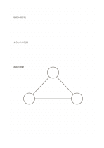

# 千鳥配置のドット方眼

`dot-staggered` · `grid-dot` · `a5-draft`

[繁體中文](README.zh-TW.md) · [English](README.en.md) · [日本語](README.ja.md) · [一覧へ戻る](../../docs/ja/catalog.md)

隣の点列を半マスずらし、斜めや三角形の配置を描きやすくします。

## 向いている場面

- 六角形や三角形状の配置を下描きするとき。
- 椅子の直線配置と千鳥配置を比べるとき。

## 使い方

1. 一列の点に沿って主な方向を決めます。
2. 半マスずれた次の列の点を結び、斜めの辺を作ります。
3. 縮尺と実際の距離を明示する必要があるか確認します。

## 記入後に見えること

方眼や点に沿って物、数、位置をそろえられます。

## 記入例

架空の展示会場で展示台を千鳥に三列並べ、通路のための隙間を残しています。

[SVG](examples/ja.svg)

## 向いていない場面

普通の長方形の表はそろえにくく、点には認証済みの製図縮尺もありません。

## ダウンロード

- [文字なしSVG](exports/a5-draft/blank.svg)
- [文字なしPDF](exports/a5-draft/blank.pdf)
- [左上に英語名があるPDF](exports/a5-draft/titled.pdf)
- [濃い線の文字なしPDF](exports/a5-contrast/blank.pdf)
- [濃い線のSVG](exports/a5-contrast/blank.svg)

英語名は表題付きPDFだけに印刷され、文字なし版は自由な記入に使えます。

用紙サイズ：A5（148 × 210 mm）。設定ファイル：`a5-draft`。

## 由来と状態

伝統的な練習紙の応用 · 詳しい由来の記録： [manifest.json](manifest.json)  
[MITライセンスの範囲](../../LICENSE-SCOPE.md)

[三言語の用語集](../../docs/ja/glossary.md)

## 変更と再生成

`profiles/a5-draft.json` または `src/noteformats/layouts/` の描画関数を変更し、プロジェクトのルートで実行します：

`python scripts/build.py --ids dot-staggered`
