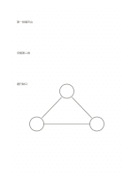

# 交錯點陣

`dot-staggered` · `grid-dot` · `a5-draft`

[繁體中文](README.zh-TW.md) · [English](README.en.md) · [日本語](README.ja.md) · [返回目錄](../../docs/zh-TW/catalog.md)

讓相鄰點列交錯，便於畫斜向與三角形配置。

## 適合情境

- 草擬六角或三角排列的物件。
- 比較直線排列與交錯排列的座位草圖。

## 使用步驟

1. 先沿一列點標出主要方向。
2. 利用下一列半格錯位的點連出斜邊。
3. 再檢查圖是否需要標明比例與實際距離。

## 整理後可得到

用格線或點位對齊物件、數量與相對位置。

## 實際填寫示例

示例把虛構展場的三排展示台排成交錯列，再留一處通行缺口。

[SVG](examples/zh-TW.svg)

## 不適合情境

一般橫直表格較難沿交錯點保持整齊；此點陣也不是已標定單位的工程紙。

## 下載

- [無字 SVG](exports/a5-draft/blank.svg)
- [無字 PDF](exports/a5-draft/blank.pdf)
- [左上角英文名稱 PDF](exports/a5-draft/titled.pdf)
- [深色墨線無字 PDF](exports/a5-contrast/blank.pdf)
- [深色墨線 SVG](exports/a5-contrast/blank.svg)

英文名稱只印在標題版 PDF；無字版仍適合自由列印與改作。

頁面尺寸：A5（148 × 210 mm）；設定檔：`a5-draft`。

## 來源與狀態

傳統書寫紙改編 · 詳細來源紀錄見 [manifest.json](manifest.json)  
[MIT 授權範圍](../../LICENSE-SCOPE.md)

[三語術語表](../../docs/zh-TW/glossary.md)

## 修改與重新生成

修改 `profiles/a5-draft.json` 或 `src/noteformats/layouts/` 內對應的繪圖函式，再於專案根目錄執行：

`python scripts/build.py --ids dot-staggered`
