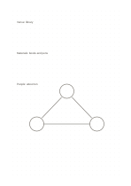

# Dot grid

`dot-standard` · `grid-dot` · `a5-draft`

[繁體中文](README.zh-TW.md) · [English](README.en.md) · [日本語](README.ja.md) · [Back to catalog](../../docs/en/catalog.md)

Use faint dots for alignment while leaving writing more open than a full square grid.

## When to use it

- Draw boxes and arrows freely but keep them roughly aligned.
- Add a small diagram beside short notes.

## How to use it

1. Treat dots as references rather than marks to fill.
2. Write the topic, then connect only the dots needed for boxes or lines.
3. Review whether the drawn structure clarifies the written notes.

## What the page helps you see

Aligned objects, counts, or spatial positions on the grid or dots.

## Worked example

Three aligned blocks describe the venue, materials, and people for a fictional neighborhood event.

[SVG](examples/en.svg)

## When not to use it

Dots can be too subtle when a clear cell boundary or continuous writing baseline is needed.

## Downloads

- [Wordless SVG](exports/a5-draft/blank.svg)
- [Wordless PDF](exports/a5-draft/blank.pdf)
- [PDF with English name at top left](exports/a5-draft/titled.pdf)
- [Darker-ink wordless PDF](exports/a5-contrast/blank.pdf)
- [Darker-ink SVG](exports/a5-contrast/blank.svg)

The English name appears only on the titled PDF; the wordless version remains available for free writing.

Page size: A5 (148 × 210 mm); profile: `a5-draft`.

## Provenance and status

Adaptation of traditional writing paper · Detailed source record: [manifest.json](manifest.json)  
[MIT license scope](../../LICENSE-SCOPE.md)

[Trilingual glossary](../../docs/en/glossary.md)

## Modify and rebuild

Change `profiles/a5-draft.json` or the corresponding builder in `src/noteformats/layouts/`, then run from the project root:

`python scripts/build.py --ids dot-standard`
