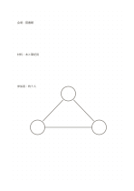

# 等間隔ドット方眼

`dot-standard` · `grid-dot` · `a5-draft`

[繁體中文](README.zh-TW.md) · [English](README.en.md) · [日本語](README.ja.md) · [一覧へ戻る](../../docs/ja/catalog.md)

薄い点で位置をそろえながら、方眼より自由な書き心地を残します。

## 向いている場面

- 枠や矢印を自由に描きつつ、おおよそそろえたいとき。
- 短いメモの横に小さな図を加えるとき。

## 使い方

1. 点は位置の目安として使い、すべてを埋めようとしません。
2. 主題を書き、必要な点だけを結んで枠や線を作ります。
3. 描いた構造が文章を分かりやすくしたか見直します。

## 記入後に見えること

方眼や点に沿って物、数、位置をそろえられます。

## 記入例

架空の地域イベントの会場、材料、担当者を三つのそろった区画で示しています。

[SVG](examples/ja.svg)

## 向いていない場面

明確なマス目や連続した書字の基準線が必要な場合、点だけでは弱すぎます。

## ダウンロード

- [文字なしSVG](exports/a5-draft/blank.svg)
- [文字なしPDF](exports/a5-draft/blank.pdf)
- [左上に英語名があるPDF](exports/a5-draft/titled.pdf)
- [濃い線の文字なしPDF](exports/a5-contrast/blank.pdf)
- [濃い線のSVG](exports/a5-contrast/blank.svg)

英語名は表題付きPDFだけに印刷され、文字なし版は自由な記入に使えます。

用紙サイズ：A5（148 × 210 mm）。設定ファイル：`a5-draft`。

## 由来と状態

伝統的な練習紙の応用 · 詳しい由来の記録： [manifest.json](manifest.json)  
[MITライセンスの範囲](../../LICENSE-SCOPE.md)

[三言語の用語集](../../docs/ja/glossary.md)

## 変更と再生成

`profiles/a5-draft.json` または `src/noteformats/layouts/` の描画関数を変更し、プロジェクトのルートで実行します：

`python scripts/build.py --ids dot-standard`
