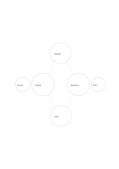

# Double-bubble comparison

`double-bubble` · `comparison` · `a5-draft`

[繁體中文](README.zh-TW.md) · [English](README.en.md) · [日本語](README.ja.md) · [Back to catalog](../../docs/en/catalog.md)

Connect two central subjects to shared and exclusive short traits.

## When to use it

- Compare two guide formats by shared aims and differences.
- Sort common functions and distinct uses of two objects.

## How to use it

1. Name the two subjects in the larger circles.
2. Use the upper and lower bubbles for traits shared by both.
3. Put each exclusive trait in an outer bubble and check each connection.

## What the page helps you see

Options compared against shared criteria rather than one impression.

## Worked example

Paper and spoken guides both offer route and information; keeping a copy and asking questions are unique traits.

[SVG](examples/en.svg)

## When not to use it

Bubbles fit short words, not evidence or numeric comparisons; use a table for detail.

## Downloads

- [Wordless SVG](exports/a5-draft/blank.svg)
- [Wordless PDF](exports/a5-draft/blank.pdf)
- [PDF with English name at top left](exports/a5-draft/titled.pdf)
- [Darker-ink wordless PDF](exports/a5-contrast/blank.pdf)
- [Darker-ink SVG](exports/a5-contrast/blank.svg)

The English name appears only on the titled PDF; the wordless version remains available for free writing.

Page size: A5 (148 × 210 mm); profile: `a5-draft`.

## Provenance and status

Adaptation of an existing method · Detailed source record: [manifest.json](manifest.json)  
[MIT license scope](../../LICENSE-SCOPE.md)

[Trilingual glossary](../../docs/en/glossary.md)

## Modify and rebuild

Change `profiles/a5-draft.json` or the corresponding builder in `src/noteformats/layouts/`, then run from the project root:

`python scripts/build.py --ids double-bubble`
