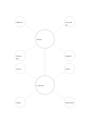

# Two-center concept map

`double-center-mindmap` · `concept-network` · `a5-draft`

[繁體中文](README.zh-TW.md) · [English](README.en.md) · [日本語](README.ja.md) · [Back to catalog](../../docs/en/catalog.md)

Keep two related topics connected while giving each its own set of surrounding ideas.

## When to use it

- Compare preparation needs for online and in-person workshops.
- Separate two authors' approaches to the same issue.

## How to use it

1. Name two related but distinct centers.
2. Add four topic-specific angles around each center.
3. Use the central link to note a shared point or a difference to verify.

## What the page helps you see

A map of topics, branches, and relationships still to verify.

## Worked example

A fictional workshop has online and in-person centers: platform, recording, interaction, and support above; venue, seats, paper, and movement below.

[SVG](examples/en.svg)

## When not to use it

Do not force every detail into two camps; use a network when many cross-links matter.

## Downloads

- [Wordless SVG](exports/a5-draft/blank.svg)
- [Wordless PDF](exports/a5-draft/blank.pdf)
- [PDF with English name at top left](exports/a5-draft/titled.pdf)
- [Darker-ink wordless PDF](exports/a5-contrast/blank.pdf)
- [Darker-ink SVG](exports/a5-contrast/blank.svg)

The English name appears only on the titled PDF; the wordless version remains available for free writing.

Page size: A5 (148 × 210 mm); profile: `a5-draft`.

## Provenance and status

Original layout · Detailed source record: [manifest.json](manifest.json)  
[MIT license scope](../../LICENSE-SCOPE.md)

[Trilingual glossary](../../docs/en/glossary.md)

## Modify and rebuild

Change `profiles/a5-draft.json` or the corresponding builder in `src/noteformats/layouts/`, then run from the project root:

`python scripts/build.py --ids double-center-mindmap`
