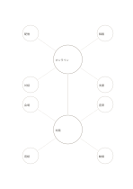

# 二つの中心を持つ概念図

`double-center-mindmap` · `concept-network` · `a5-draft`

[繁體中文](README.zh-TW.md) · [English](README.en.md) · [日本語](README.ja.md) · [一覧へ戻る](../../docs/ja/catalog.md)

関係する二つのテーマをつなぎつつ、それぞれの周辺項目を分けます。

## 向いている場面

- オンラインと対面の講座の準備条件を比べるとき。
- 同じ話題に対する二人の著者の着眼点を分けるとき。

## 使い方

1. 上下に関係はあるが異なるテーマを書きます。
2. 各中心の周囲に固有の観点を四つ置きます。
3. 中央の線には共通点や確かめるべき違いを読み取ります。

## 記入後に見えること

主題と枝、確かめ直す関係を一覧できます。

## 記入例

架空の講座で上はオンラインの配信、録画、対話、支援、下は対面の会場、座席、用紙、動線を整理します。

[SVG](examples/ja.svg)

## 向いていない場面

すべてを二群に押し込まないでください。交差する関係が多ければネットワーク図が向きます。

## ダウンロード

- [文字なしSVG](exports/a5-draft/blank.svg)
- [文字なしPDF](exports/a5-draft/blank.pdf)
- [左上に英語名があるPDF](exports/a5-draft/titled.pdf)
- [濃い線の文字なしPDF](exports/a5-contrast/blank.pdf)
- [濃い線のSVG](exports/a5-contrast/blank.svg)

英語名は表題付きPDFだけに印刷され、文字なし版は自由な記入に使えます。

用紙サイズ：A5（148 × 210 mm）。設定ファイル：`a5-draft`。

## 由来と状態

本プロジェクトの独自レイアウト · 詳しい由来の記録： [manifest.json](manifest.json)  
[MITライセンスの範囲](../../LICENSE-SCOPE.md)

[三言語の用語集](../../docs/ja/glossary.md)

## 変更と再生成

`profiles/a5-draft.json` または `src/noteformats/layouts/` の描画関数を変更し、プロジェクトのルートで実行します：

`python scripts/build.py --ids double-center-mindmap`
