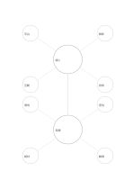

# 雙核心概念圖

`double-center-mindmap` · `concept-network` · `a5-draft`

[繁體中文](README.zh-TW.md) · [English](README.en.md) · [日本語](README.ja.md) · [返回目錄](../../docs/zh-TW/catalog.md)

並排看兩個相關主題的周邊想法，保留它們之間的連結。

## 適合情境

- 比較線上與現場工作坊的準備條件。
- 閱讀兩位作者對同一議題的不同切入點。

## 使用步驟

1. 上、下核心各寫一個相關但不同的主題。
2. 各核心周圍記四個專屬面向。
3. 沿中央連線補寫共同點或需核對的差別。

## 整理後可得到

看見主題、分支及需要再確認的關係。

## 實際填寫示例

虛構工作坊把線上與現場作為雙核心，上方列平台、錄影、遠端互動、技術，下方列場地、座位、紙材、動線。

[SVG](examples/zh-TW.svg)

## 不適合情境

不適合把所有細節都強迫分成兩組；交叉關係很多時改用網絡圖。

## 下載

- [無字 SVG](exports/a5-draft/blank.svg)
- [無字 PDF](exports/a5-draft/blank.pdf)
- [左上角英文名稱 PDF](exports/a5-draft/titled.pdf)
- [深色墨線無字 PDF](exports/a5-contrast/blank.pdf)
- [深色墨線 SVG](exports/a5-contrast/blank.svg)

英文名稱只印在標題版 PDF；無字版仍適合自由列印與改作。

頁面尺寸：A5（148 × 210 mm）；設定檔：`a5-draft`。

## 來源與狀態

本專案原創版面 · 詳細來源紀錄見 [manifest.json](manifest.json)  
[MIT 授權範圍](../../LICENSE-SCOPE.md)

[三語術語表](../../docs/zh-TW/glossary.md)

## 修改與重新生成

修改 `profiles/a5-draft.json` 或 `src/noteformats/layouts/` 內對應的繪圖函式，再於專案根目錄執行：

`python scripts/build.py --ids double-center-mindmap`
