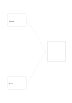

# Two-input synthesis

`dual-input-synthesis` · `ideation` · `a5-draft`

[繁體中文](README.zh-TW.md) · [English](README.en.md) · [日本語](README.ja.md) · [Back to catalog](../../docs/en/catalog.md)

Bring two different inputs toward one provisional synthesis. Geometry change: converging inputs: 2.

## When to use it

**Geometry relationship:** `parameter` · [converging-flow](../converging-flow/README.en.md)

- Put two articles' main points in the two input boxes and write a supportable synthesis on the right.
- Combine interview findings and direct observation as two inputs, recording agreement and unresolved conflicts.

## How to use it

1. Place an input in each left box and the synthesis on the right, tracing each contribution.
2. Use the worked example to place entries in region order: 1: "People"; 2: "Books"; 3: "Small trial"
3. Review the regions, mark open questions and choose a next step.

## What the page helps you see

Multiple proposals with a basis for the next selection step.

## Worked example

Entries in example-position order; each number identifies one entry:

1. People
2. Books
3. Small trial

[SVG](examples/en.svg)

## When not to use it

Arrows show information flow, not proven causation; a feedback loop needs a cycle diagram. Small cells hold short phrases rather than long paragraphs.

## Downloads

- [Wordless SVG](exports/a5-draft/blank.svg)
- [Wordless PDF](exports/a5-draft/blank.pdf)
- [PDF with English name at top left](exports/a5-draft/titled.pdf)
- [Darker-ink wordless PDF](exports/a5-contrast/blank.pdf)
- [Darker-ink SVG](exports/a5-contrast/blank.svg)

The English name appears only on the titled PDF; the wordless version remains available for free writing.

Page size: A5 (148 × 210 mm); profile: `a5-draft`.

## Provenance and status

Generic geometry · Detailed source record: [manifest.json](manifest.json)  
[MIT license scope](../../LICENSE-SCOPE.md)

[Trilingual glossary](../../docs/en/glossary.md)

## Modify and rebuild

Edit geometry in `src/noteformats/variants.py` or text in `src/noteformats/variant_content.py`, then run from the project root:

`python scripts/build.py --ids dual-input-synthesis`
