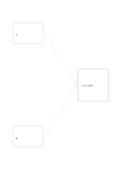

# 二つの入力をまとめる図

`dual-input-synthesis` · `ideation` · `a5-draft`

[繁體中文](README.zh-TW.md) · [English](README.en.md) · [日本語](README.ja.md) · [一覧へ戻る](../../docs/ja/catalog.md)

異なる二つの入力を一つの暫定的なまとめへつなげます。 図形の変更： 合流する入力数: 2.

## 向いている場面

**図形の対応:** `parameter` · [converging-flow](../converging-flow/README.ja.md)

- 二記事の要点を左の二枠に置き、右に根拠のある統合見解を書くとき。
- 聞き取りと現場観察を二つの入力として、共通点と残る食い違いをまとめるとき。

## 使い方

1. 左の枠に入力、右に統合結果を書き、矢印に沿って各寄与を確認します。
2. 記入例を参考に、領域の順で記します：1「人」；2「本」；3「小さく試す」
3. 各領域を読み返し、未確認の点と次の行動を記します。

## 記入後に見えること

複数の案と、次に選ぶための基準が残ります。

## 記入例

図の記入位置の順に示します。番号一つが一つの記入例です：

1. 人
2. 本
3. 小さく試す

[SVG](examples/ja.svg)

## 向いていない場面

矢印は情報の流れで、因果関係の証明ではありません。戻りがあるなら循環図を使います。 小さなマスは短い語句向けで、長い文章には向きません。

## ダウンロード

- [文字なしSVG](exports/a5-draft/blank.svg)
- [文字なしPDF](exports/a5-draft/blank.pdf)
- [左上に英語名があるPDF](exports/a5-draft/titled.pdf)
- [濃い線の文字なしPDF](exports/a5-contrast/blank.pdf)
- [濃い線のSVG](exports/a5-contrast/blank.svg)

英語名は表題付きPDFだけに印刷され、文字なし版は自由な記入に使えます。

用紙サイズ：A5（148 × 210 mm）。設定ファイル：`a5-draft`。

## 由来と状態

一般的な幾何構造 · 詳しい由来の記録： [manifest.json](manifest.json)  
[MITライセンスの範囲](../../LICENSE-SCOPE.md)

[三言語の用語集](../../docs/ja/glossary.md)

## 変更と再生成

図形は `src/noteformats/variants.py`、文章は `src/noteformats/variant_content.py` を変更し、プロジェクトのルートで実行します：

`python scripts/build.py --ids dual-input-synthesis`
