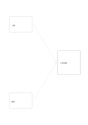

# 雙輸入綜合圖

`dual-input-synthesis` · `ideation` · `a5-draft`

[繁體中文](README.zh-TW.md) · [English](README.en.md) · [日本語](README.ja.md) · [返回目錄](../../docs/zh-TW/catalog.md)

由兩項不同輸入共同推向一個暫定綜合結果。 本款的幾何變化： 匯入來源數: 2.

## 適合情境

**幾何對照:** `parameter` · [converging-flow](../converging-flow/README.zh-TW.md)

- 把兩篇文章的重點分置左側兩框，右側寫出可支持的整合觀點。
- 將訪談發現與現場觀察作為兩個輸入，整理共同結論與仍有衝突的地方。

## 使用步驟

1. 左側各框放一個輸入來源，右側寫整合結果，沿箭頭說明來源貢獻。
2. 參考本頁示例，各區依序記錄：1「人員」；2「書目」；3「小型試辦」
3. 回看各區，標記仍待查證的內容，再決定下一步。

## 整理後可得到

保留多種方案並說明下一輪篩選依據。

## 實際填寫示例

依圖中填寫位置順序列出，每個編號是一筆示例條目：

1. 人員
2. 書目
3. 小型試辦

[SVG](examples/zh-TW.svg)

## 不適合情境

箭頭只表示資訊流，不證明三項因素有因果關係；需要回饋迴路時另選循環圖。 細小格子只宜短語，不適合長篇段落。

## 下載

- [無字 SVG](exports/a5-draft/blank.svg)
- [無字 PDF](exports/a5-draft/blank.pdf)
- [左上角英文名稱 PDF](exports/a5-draft/titled.pdf)
- [深色墨線無字 PDF](exports/a5-contrast/blank.pdf)
- [深色墨線 SVG](exports/a5-contrast/blank.svg)

英文名稱只印在標題版 PDF；無字版仍適合自由列印與改作。

頁面尺寸：A5（148 × 210 mm）；設定檔：`a5-draft`。

## 來源與狀態

通用幾何結構 · 詳細來源紀錄見 [manifest.json](manifest.json)  
[MIT 授權範圍](../../LICENSE-SCOPE.md)

[三語術語表](../../docs/zh-TW/glossary.md)

## 修改與重新生成

調整 `src/noteformats/variants.py` 的幾何或 `src/noteformats/variant_content.py` 的文字，再於專案根目錄執行：

`python scripts/build.py --ids dual-input-synthesis`
