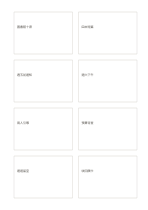

# 八張獨立卡

`eight-cards` · `cards` · `a5-draft`

[繁體中文](README.zh-TW.md) · [English](README.en.md) · [日本語](README.ja.md) · [返回目錄](../../docs/zh-TW/catalog.md)

將多個候選想法放進各自的獨立卡片，再比較或排序。 本款的幾何變化： 獨立卡片數: 8.

## 適合情境

**幾何對照:** `parameter` · [four-cards](../four-cards/README.zh-TW.md)

- 用八張等大的卡整理八項展品的說明草稿。
- 把八個彼此可獨立處理的議題分開記錄，之後再排序。

## 使用步驟

1. 先決定各卡是不同方案還是同一主題的不同面向，每張只放一個可比較單位。
2. 參考本頁示例，各區依序記錄：1「圖書館十席」；2「四本短篇」；3「週五前通知」；4「週六下午」；5「兩人引導」；6「預算待查」；7「通道留空」；8「收回饋卡」
3. 回看各區，標記仍待查證的內容，再決定下一步。

## 整理後可得到

把可移動的事項分開，方便排序、比較或選擇。

## 實際填寫示例

依圖中填寫位置順序列出，每個編號是一筆示例條目：

1. 圖書館十席
2. 四本短篇
3. 週五前通知
4. 週六下午
5. 兩人引導
6. 預算待查
7. 通道留空
8. 收回饋卡

[SVG](examples/zh-TW.svg)

## 不適合情境

八個等大區塊不會自動區分主次或優先級；內容長短差異很大時，強行平均分配會讓部分卡片擁擠。

## 下載

- [無字 SVG](exports/a5-draft/blank.svg)
- [無字 PDF](exports/a5-draft/blank.pdf)
- [左上角英文名稱 PDF](exports/a5-draft/titled.pdf)
- [深色墨線無字 PDF](exports/a5-contrast/blank.pdf)
- [深色墨線 SVG](exports/a5-contrast/blank.svg)

英文名稱只印在標題版 PDF；無字版仍適合自由列印與改作。

頁面尺寸：A5（148 × 210 mm）；設定檔：`a5-draft`。

## 來源與狀態

通用幾何結構 · 詳細來源紀錄見 [manifest.json](manifest.json)  
[MIT 授權範圍](../../LICENSE-SCOPE.md)

[三語術語表](../../docs/zh-TW/glossary.md)

## 修改與重新生成

調整 `src/noteformats/variants.py` 的幾何或 `src/noteformats/variant_content.py` 的文字，再於專案根目錄執行：

`python scripts/build.py --ids eight-cards`
