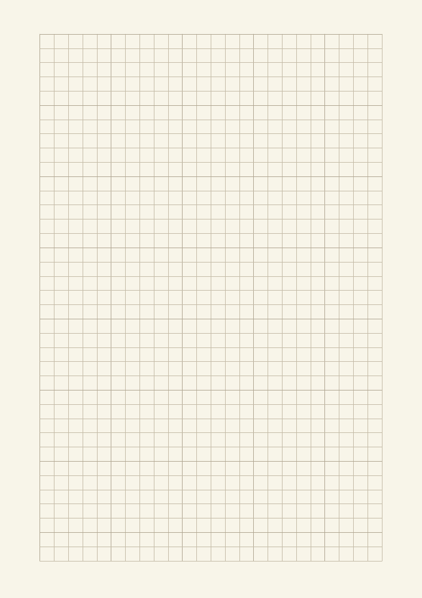
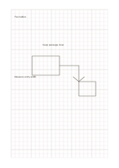

# Engineering grid

`engineering-grid` · `geometry` · `a5-draft`

[繁體中文](README.zh-TW.md) · [English](README.en.md) · [日本語](README.ja.md) · [Back to catalog](../../docs/en/catalog.md)

Align short notes, simple drawings, and proportional drafts on equal squares. Geometry change: Every fifth grid line is emphasized.

## When to use it

**Geometry relationship:** `parameter` · [grid-standard](../grid-standard/README.en.md)

- Locate a mechanism sketch with every-fifth-cell guides and use the fine grid for local proportions.
- Compare component outlines while distinguishing overall and detail units through the grid hierarchy.

## How to use it

1. Decide what one square represents on this page.
2. Place lines or short labels on the grid and leave adjacent cells for notes.
3. Check scale assumptions afterward and record real measurements separately.

## What the page helps you see

A draft of direction, proportion, or placement, with measurements still to check.

## Worked example

A fictional reading corner uses cells for a table, chairs, and passage, with a width still to measure. The fictional entries indicate where short notes belong; they are neither measured data nor a complete research conclusion.

[SVG](examples/en.svg)

## When not to use it

Every-fifth-cell guides help alignment but do not supply tolerances, a scale or dimensions; a drawing intended for fabrication needs a separate specification.

## Downloads

- [Wordless SVG](exports/a5-draft/blank.svg)
- [Wordless PDF](exports/a5-draft/blank.pdf)
- [PDF with English name at top left](exports/a5-draft/titled.pdf)
- [Darker-ink wordless PDF](exports/a5-contrast/blank.pdf)
- [Darker-ink SVG](exports/a5-contrast/blank.svg)

The English name appears only on the titled PDF; the wordless version remains available for free writing.

Page size: A5 (148 × 210 mm); profile: `a5-draft`.

## Provenance and status

Adaptation of traditional writing paper · Detailed source record: [manifest.json](manifest.json)  
[MIT license scope](../../LICENSE-SCOPE.md)

[Trilingual glossary](../../docs/en/glossary.md)

## Modify and rebuild

Edit geometry in `src/noteformats/variants.py` or text in `src/noteformats/variant_content.py`, then run from the project root:

`python scripts/build.py --ids engineering-grid`
