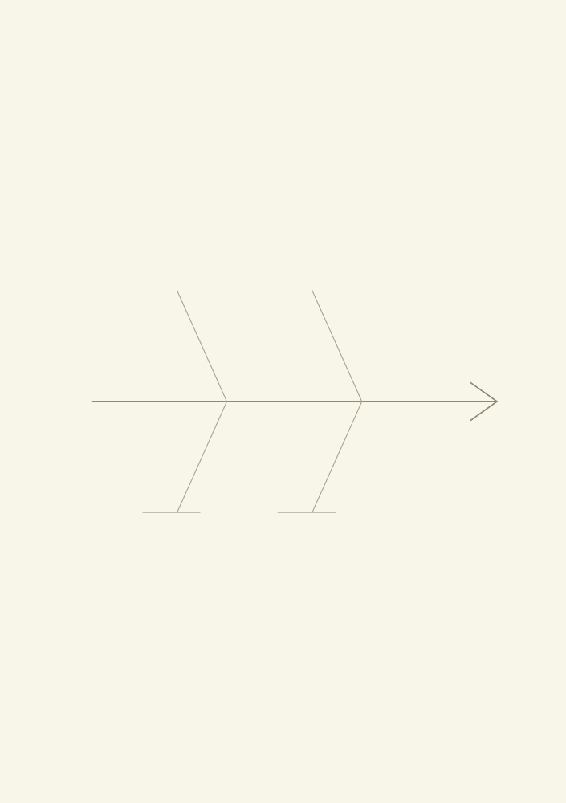
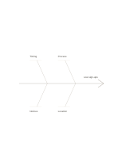

# Four-branch fishbone

`fishbone-four` · `causal` · `a5-draft`

[繁體中文](README.zh-TW.md) · [English](README.en.md) · [日本語](README.ja.md) · [Back to catalog](../../docs/en/catalog.md)

Separate an observed problem from several groups of possible causes and their subcauses. Geometry change: cause branches per side: 2.

## When to use it

**Geometry relationship:** `parameter` · [fishbone](../fishbone/README.en.md)

- Group low event participation hypotheses into notice, timing, location and registration method.
- Sort possible causes of recurring missing items into four groups before adding evidence leads on branches.

## How to use it

1. Put the problem at the head, a cause category on each main bone and checkable conditions on sub-branches.
2. Use the worked example to place entries in region order: 1: "Timing"; 2: "Notices"; 3: "Process"; 4: "Location"; 5: "Low sign-ups"
3. Review the regions, mark open questions and choose a next step.

## What the page helps you see

Observed outcomes separated from causal hypotheses and unsupported links.

## Worked example

Entries in example-position order; each number identifies one entry:

1. Timing
2. Notices
3. Process
4. Location
5. Low sign-ups

[SVG](examples/en.svg)

## When not to use it

The diagram organizes hypotheses; without evidence, its lines cannot establish that a cause is real. Small cells hold short phrases rather than long paragraphs.

## Downloads

- [Wordless SVG](exports/a5-draft/blank.svg)
- [Wordless PDF](exports/a5-draft/blank.pdf)
- [PDF with English name at top left](exports/a5-draft/titled.pdf)
- [Darker-ink wordless PDF](exports/a5-contrast/blank.pdf)
- [Darker-ink SVG](exports/a5-contrast/blank.svg)

The English name appears only on the titled PDF; the wordless version remains available for free writing.

Page size: A5 (148 × 210 mm); profile: `a5-draft`.

## Provenance and status

Adaptation of an existing method · Detailed source record: [manifest.json](manifest.json)  
[MIT license scope](../../LICENSE-SCOPE.md)

[Trilingual glossary](../../docs/en/glossary.md)

## Modify and rebuild

Edit geometry in `src/noteformats/variants.py` or text in `src/noteformats/variant_content.py`, then run from the project root:

`python scripts/build.py --ids fishbone-four`
