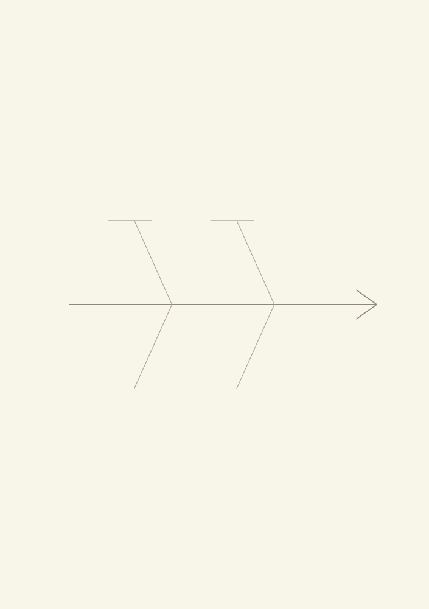
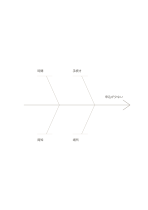

# 四組の魚骨図

`fishbone-four` · `causal` · `a5-draft`

[繁體中文](README.zh-TW.md) · [English](README.en.md) · [日本語](README.ja.md) · [一覧へ戻る](../../docs/ja/catalog.md)

観察した問題と複数の原因候補、その下位要因を分けます。 図形の変更： 片側の原因枝数: 2.

## 向いている場面

**図形の対応:** `parameter` · [fishbone](../fishbone/README.ja.md)

- 催しの参加が少ない理由を、案内・時間・場所・申込方法の四分類で仮説にするとき。
- 繰り返す入れ忘れの原因候補を四群に分け、枝に調べる手がかりを追加するとき。

## 使い方

1. 頭に問題、主枝に原因の分類、下位の枝に確かめる条件を書きます。
2. 記入例を参考に、領域の順で記します：1「時間」；2「周知」；3「手続き」；4「場所」；5「申込が少ない」
3. 各領域を読み返し、未確認の点と次の行動を記します。

## 記入後に見えること

観察結果と原因の仮説を分け、根拠のない関係を示せます。

## 記入例

図の記入位置の順に示します。番号一つが一つの記入例です：

1. 時間
2. 周知
3. 手続き
4. 場所
5. 申込が少ない

[SVG](examples/ja.svg)

## 向いていない場面

図は仮説の整理用です。根拠がないまま線を結んでも、因果関係が証明されたことにはなりません。 小さなマスは短い語句向けで、長い文章には向きません。

## ダウンロード

- [文字なしSVG](exports/a5-draft/blank.svg)
- [文字なしPDF](exports/a5-draft/blank.pdf)
- [左上に英語名があるPDF](exports/a5-draft/titled.pdf)
- [濃い線の文字なしPDF](exports/a5-contrast/blank.pdf)
- [濃い線のSVG](exports/a5-contrast/blank.svg)

英語名は表題付きPDFだけに印刷され、文字なし版は自由な記入に使えます。

用紙サイズ：A5（148 × 210 mm）。設定ファイル：`a5-draft`。

## 由来と状態

既存の方法を配置に応用 · 詳しい由来の記録： [manifest.json](manifest.json)  
[MITライセンスの範囲](../../LICENSE-SCOPE.md)

[三言語の用語集](../../docs/ja/glossary.md)

## 変更と再生成

図形は `src/noteformats/variants.py`、文章は `src/noteformats/variant_content.py` を変更し、プロジェクトのルートで実行します：

`python scripts/build.py --ids fishbone-four`
