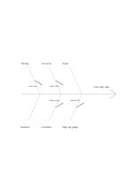

# Fishbone diagram

`fishbone` · `causal` · `a5-draft`

[繁體中文](README.zh-TW.md) · [English](README.en.md) · [日本語](README.ja.md) · [Back to catalog](../../docs/en/catalog.md)

Work backward from an observed outcome to possible causes instead of settling on the first explanation.

## When to use it

- Explore why sign-ups for an event were low across publicity, timing, and process.
- Sort hypotheses about repeated production errors across people, materials, and steps.

## How to use it

1. Write a specific observable outcome at the right end without assigning blame.
2. Give each branch a cause category relevant to the situation.
3. Add possible causes beside the branches, separating guesses from evidence.
4. Choose which causes to check first and note what information to collect.

## What the page helps you see

Observed outcomes separated from causal hypotheses and unsupported links.

## Worked example

A fictional event with low sign-ups has branches for timing, notices, process, location, topic, and the registration page, all awaiting checks.

[SVG](examples/en.svg)

## When not to use it

The diagram organizes hypotheses; without evidence, its lines cannot establish that a cause is real.

## Downloads

- [Wordless SVG](exports/a5-draft/blank.svg)
- [Wordless PDF](exports/a5-draft/blank.pdf)
- [PDF with English name at top left](exports/a5-draft/titled.pdf)
- [Darker-ink wordless PDF](exports/a5-contrast/blank.pdf)
- [Darker-ink SVG](exports/a5-contrast/blank.svg)

The English name appears only on the titled PDF; the wordless version remains available for free writing.

Page size: A5 (148 × 210 mm); profile: `a5-draft`.

## Provenance and status

Adaptation of an existing method · Detailed source record: [manifest.json](manifest.json)  
[MIT license scope](../../LICENSE-SCOPE.md)

[Trilingual glossary](../../docs/en/glossary.md)

## Modify and rebuild

Change `profiles/a5-draft.json` or the corresponding builder in `src/noteformats/layouts/`, then run from the project root:

`python scripts/build.py --ids fishbone`
