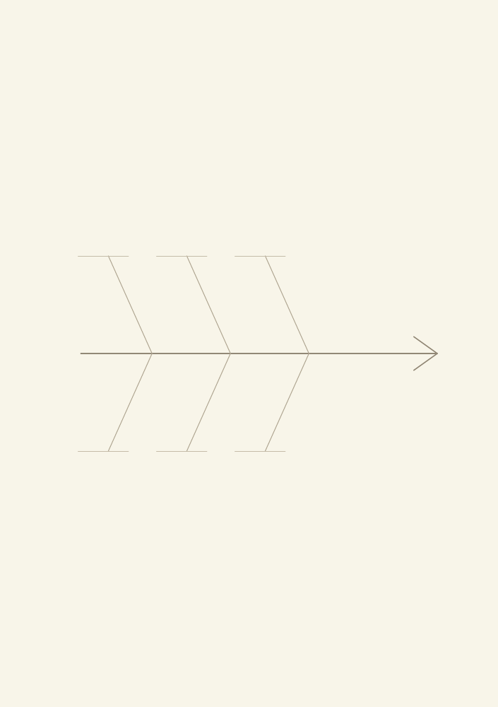
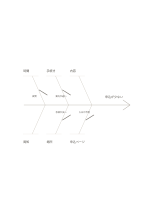

# 特性要因図

`fishbone` · `causal` · `a5-draft`

[繁體中文](README.zh-TW.md) · [English](README.en.md) · [日本語](README.ja.md) · [一覧へ戻る](../../docs/ja/catalog.md)

観察した結果から考えられる原因をさかのぼり、最初の説明だけで決めつけないための図です。

## 向いている場面

- 催しの申込が少ない理由を、周知、時間、手続きなどから探るとき。
- 制作中の繰り返す誤りを、人、材料、工程の仮説に分けるとき。

## 使い方

1. 右端に具体的に観察できる結果を書き、責任を先に決めません。
2. 各枝に、その問題に合う原因の分類を自分で付けます。
3. 枝の近くに候補を書き、推測と確認済みの事実を分けます。
4. 優先して確かめる候補を選び、集める情報を書きます。

## 記入後に見えること

観察結果と原因の仮説を分け、根拠のない関係を示せます。

## 記入例

架空の催しで申込が少なかった状況を例に、時間、周知、手続き、場所、内容、申込ページを確認候補として書いています。

[SVG](examples/ja.svg)

## 向いていない場面

図は仮説の整理用です。根拠がないまま線を結んでも、因果関係が証明されたことにはなりません。

## ダウンロード

- [文字なしSVG](exports/a5-draft/blank.svg)
- [文字なしPDF](exports/a5-draft/blank.pdf)
- [左上に英語名があるPDF](exports/a5-draft/titled.pdf)
- [濃い線の文字なしPDF](exports/a5-contrast/blank.pdf)
- [濃い線のSVG](exports/a5-contrast/blank.svg)

英語名は表題付きPDFだけに印刷され、文字なし版は自由な記入に使えます。

用紙サイズ：A5（148 × 210 mm）。設定ファイル：`a5-draft`。

## 由来と状態

既存の方法を配置に応用 · 詳しい由来の記録： [manifest.json](manifest.json)  
[MITライセンスの範囲](../../LICENSE-SCOPE.md)

[三言語の用語集](../../docs/ja/glossary.md)

## 変更と再生成

`profiles/a5-draft.json` または `src/noteformats/layouts/` の描画関数を変更し、プロジェクトのルートで実行します：

`python scripts/build.py --ids fishbone`
