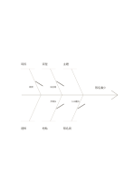

# 魚骨因果圖

`fishbone` · `causal` · `a5-draft`

[繁體中文](README.zh-TW.md) · [English](README.en.md) · [日本語](README.ja.md) · [返回目錄](../../docs/zh-TW/catalog.md)

從一個待釐清的結果往回列可能原因，避免只盯著第一個解釋。

## 適合情境

- 活動報名偏少時，探索宣傳、時間與流程等可能原因。
- 製作過程有反覆錯誤時，整理人員、材料和步驟方面的假設。

## 使用步驟

1. 在右端寫下具體、可觀察的結果，不先寫責任歸屬。
2. 沿著主幹替各分枝自訂原因類別。
3. 在每枝旁寫可能原因，將推測與已有證據分開。
4. 選出最值得查證的原因，寫下下一步要蒐集的資料。

## 整理後可得到

分開觀察結果與原因假設，標出尚無證據的連結。

## 實際填寫示例

以虛構活動報名偏少為結果，上下分枝暫記時段、通知、流程、地點、主題與報名頁，作為後續查證清單。

[SVG](examples/zh-TW.svg)

## 不適合情境

這張圖只能整理假設；沒有資料時不能從線條推論因果已被證實。

## 下載

- [無字 SVG](exports/a5-draft/blank.svg)
- [無字 PDF](exports/a5-draft/blank.pdf)
- [左上角英文名稱 PDF](exports/a5-draft/titled.pdf)
- [深色墨線無字 PDF](exports/a5-contrast/blank.pdf)
- [深色墨線 SVG](exports/a5-contrast/blank.svg)

英文名稱只印在標題版 PDF；無字版仍適合自由列印與改作。

頁面尺寸：A5（148 × 210 mm）；設定檔：`a5-draft`。

## 來源與狀態

既有方法的版面改編 · 詳細來源紀錄見 [manifest.json](manifest.json)  
[MIT 授權範圍](../../LICENSE-SCOPE.md)

[三語術語表](../../docs/zh-TW/glossary.md)

## 修改與重新生成

修改 `profiles/a5-draft.json` 或 `src/noteformats/layouts/` 內對應的繪圖函式，再於專案根目錄執行：

`python scripts/build.py --ids fishbone`
