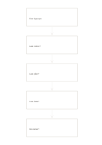

# Five-whys chain

`five-why-chain` · `causal` · `a5-draft`

[繁體中文](README.zh-TW.md) · [English](README.en.md) · [日本語](README.ja.md) · [Back to catalog](../../docs/en/catalog.md)

Ask why repeatedly from an observed problem, recording each answer as a hypothesis to check.

## When to use it

**Geometry relationship:** `equivalent` · [flow-five-vertical](../flow-five-vertical/README.en.md)

- Investigate low event sign-ups by repeatedly asking why from the observed problem and treating answers as hypotheses.
- Examine recurring missing materials in five boxes, recording follow-up questions and evidence gaps rather than guessing to fill cells.

## How to use it

1. State an observable problem without presenting a guess as the problem itself.
2. Ask why the previous answer occurred in each next box and note evidence that supports or challenges it.
3. Mark evidence gaps; stop early or branch elsewhere when needed rather than forcing five answers.

## What the page helps you see

Observed outcomes separated from causal hypotheses and unsupported links.

## Worked example

Entries in example-position order; each number identifies one entry:

1. Few sign-ups
2. Late notice?
3. Late plan?
4. Late data?
5. No owner?

[SVG](examples/en.svg)

## When not to use it

One questioning chain cannot cover interacting causes; writing five answers does not establish causation.

## Downloads

- [Wordless SVG](exports/a5-draft/blank.svg)
- [Wordless PDF](exports/a5-draft/blank.pdf)
- [PDF with English name at top left](exports/a5-draft/titled.pdf)
- [Darker-ink wordless PDF](exports/a5-contrast/blank.pdf)
- [Darker-ink SVG](exports/a5-contrast/blank.svg)

The English name appears only on the titled PDF; the wordless version remains available for free writing.

Page size: A5 (148 × 210 mm); profile: `a5-draft`.

## Provenance and status

Generic geometry · Detailed source record: [manifest.json](manifest.json)  
[MIT license scope](../../LICENSE-SCOPE.md)

[Trilingual glossary](../../docs/en/glossary.md)

## Modify and rebuild

Edit geometry in `src/noteformats/variants.py` or text in `src/noteformats/variant_content.py`, then run from the project root:

`python scripts/build.py --ids five-why-chain`
