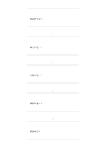

# 五回のなぜの連鎖

`five-why-chain` · `causal` · `a5-draft`

[繁體中文](README.zh-TW.md) · [English](README.en.md) · [日本語](README.ja.md) · [一覧へ戻る](../../docs/ja/catalog.md)

観察した問題から『なぜ』を重ね、各答えを確かめる仮説として残します。

## 向いている場面

**図形の対応:** `equivalent` · [flow-five-vertical](../flow-five-vertical/README.ja.md)

- 催しの申込が少ないという観察から『なぜ』を重ね、各答えを仮説として調べるとき。
- 材料の提出漏れが繰り返す理由を五枠で追い、枠を埋めるための推測ではなく問いと根拠の不足を記すとき。

## 使い方

1. 観察できる問題を書き、推測を問題そのものとして扱わないようにします。
2. 次の枠で直前の答えの『なぜ』を問い、支持する根拠や反例を記します。
3. 根拠が足りなければ確認待ちとし、五回に合わせず途中で止めたり別の枝を作ったりします。

## 記入後に見えること

観察結果と原因の仮説を分け、根拠のない関係を示せます。

## 記入例

図の記入位置の順に示します。番号一つが一つの記入例です：

1. 申込が少ない
2. 案内が遅い？
3. 計画が遅い？
4. 資料が遅い？
5. 担当未定？

[SVG](examples/ja.svg)

## 向いていない場面

一本の問いの鎖だけでは相互に影響する原因を扱いきれず、五つの答えを書いても因果は証明できません。

## ダウンロード

- [文字なしSVG](exports/a5-draft/blank.svg)
- [文字なしPDF](exports/a5-draft/blank.pdf)
- [左上に英語名があるPDF](exports/a5-draft/titled.pdf)
- [濃い線の文字なしPDF](exports/a5-contrast/blank.pdf)
- [濃い線のSVG](exports/a5-contrast/blank.svg)

英語名は表題付きPDFだけに印刷され、文字なし版は自由な記入に使えます。

用紙サイズ：A5（148 × 210 mm）。設定ファイル：`a5-draft`。

## 由来と状態

一般的な幾何構造 · 詳しい由来の記録： [manifest.json](manifest.json)  
[MITライセンスの範囲](../../LICENSE-SCOPE.md)

[三言語の用語集](../../docs/ja/glossary.md)

## 変更と再生成

図形は `src/noteformats/variants.py`、文章は `src/noteformats/variant_content.py` を変更し、プロジェクトのルートで実行します：

`python scripts/build.py --ids five-why-chain`
