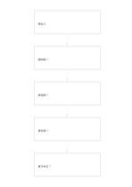

# 五層追問鏈

`five-why-chain` · `causal` · `a5-draft`

[繁體中文](README.zh-TW.md) · [English](README.en.md) · [日本語](README.ja.md) · [返回目錄](../../docs/zh-TW/catalog.md)

由觀察到的問題連續追問為什麼，逐層記錄待查證的原因假設。

## 適合情境

**幾何對照:** `equivalent` · [flow-five-vertical](../flow-five-vertical/README.zh-TW.md)

- 活動報名偏少時，從觀察到的問題逐層追問為什麼，將每個回答視為待查假設。
- 追查反覆漏交材料的原因，在五格內記錄追問與證據缺口，不為填滿格子而猜答案。

## 使用步驟

1. 先寫下可觀察的問題，避免把推測當成問題本身。
2. 逐格追問前一個回答為什麼會發生，並記下支持或反駁它的線索。
3. 證據不足時標記待查；可以提早停止或另開分枝，不必湊滿五次。

## 整理後可得到

分開觀察結果與原因假設，標出尚無證據的連結。

## 實際填寫示例

依圖中填寫位置順序列出，每個編號是一筆示例條目：

1. 報名少
2. 通知晚？
3. 排程晚？
4. 資料晚？
5. 責任未定？

[SVG](examples/zh-TW.svg)

## 不適合情境

一條追問鏈不能涵蓋互相影響的多個原因；連續寫下五個回答也不等於證明因果。

## 下載

- [無字 SVG](exports/a5-draft/blank.svg)
- [無字 PDF](exports/a5-draft/blank.pdf)
- [左上角英文名稱 PDF](exports/a5-draft/titled.pdf)
- [深色墨線無字 PDF](exports/a5-contrast/blank.pdf)
- [深色墨線 SVG](exports/a5-contrast/blank.svg)

英文名稱只印在標題版 PDF；無字版仍適合自由列印與改作。

頁面尺寸：A5（148 × 210 mm）；設定檔：`a5-draft`。

## 來源與狀態

通用幾何結構 · 詳細來源紀錄見 [manifest.json](manifest.json)  
[MIT 授權範圍](../../LICENSE-SCOPE.md)

[三語術語表](../../docs/zh-TW/glossary.md)

## 修改與重新生成

調整 `src/noteformats/variants.py` 的幾何或 `src/noteformats/variant_content.py` 的文字，再於專案根目錄執行：

`python scripts/build.py --ids five-why-chain`
