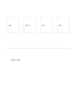

# 流れ図と自由な補足欄

`flow-and-free` · `hybrid` · `a5-draft`

[繁體中文](README.zh-TW.md) · [English](README.en.md) · [日本語](README.ja.md) · [一覧へ戻る](../../docs/ja/catalog.md)

上に四つの主な手順を置き、下に例外や現場の観察を自由に描きます。

## 向いている場面

- 催しの申込と例外を考えるとき。
- 本を借りる流れに利用者の問題を足すとき。

## 使い方

1. 上の四枠に主な行動を順に書きます。
2. 下の余白に例外、戻り道、観察を描きます。
3. 補足で主な流れが変わるなら上も直します。

## 記入後に見えること

図、短い記録、結論を分けながら関係づけられます。

## 記入例

架空の貸出を『探す、借りる、読む、返す』とし、下に未所蔵や返却遅れの枝を描きます。

[SVG](examples/ja.svg)

## 向いていない場面

四段は概要にすぎません。複雑な分岐や担当者は完全な流れ図やスイムレーンで示します。

## ダウンロード

- [文字なしSVG](exports/a5-draft/blank.svg)
- [文字なしPDF](exports/a5-draft/blank.pdf)
- [左上に英語名があるPDF](exports/a5-draft/titled.pdf)
- [濃い線の文字なしPDF](exports/a5-contrast/blank.pdf)
- [濃い線のSVG](exports/a5-contrast/blank.svg)

英語名は表題付きPDFだけに印刷され、文字なし版は自由な記入に使えます。

用紙サイズ：A5（148 × 210 mm）。設定ファイル：`a5-draft`。

## 由来と状態

本プロジェクトの独自レイアウト · 詳しい由来の記録： [manifest.json](manifest.json)  
[MITライセンスの範囲](../../LICENSE-SCOPE.md)

[三言語の用語集](../../docs/ja/glossary.md)

## 変更と再生成

`profiles/a5-draft.json` または `src/noteformats/layouts/` の描画関数を変更し、プロジェクトのルートで実行します：

`python scripts/build.py --ids flow-and-free`
