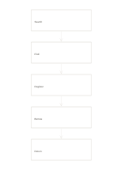

# Five-step vertical flow

`flow-five-vertical` · `flow` · `a5-draft`

[繁體中文](README.zh-TW.md) · [English](README.en.md) · [日本語](README.ja.md) · [Back to catalog](../../docs/en/catalog.md)

Trace five consecutive steps from top to bottom and check each transition. Geometry change: vertical steps: 5.

## When to use it

**Geometry relationship:** `parameter` · [flow-four-horizontal](../flow-four-horizontal/README.en.md)

- List five service steps vertically: receive, log, assign, handle and reply.
- Map a five-stage handoff from top to bottom, noting what each next step receives.

## How to use it

1. Fill five connected steps or questions from top to bottom; each arrow links neighboring boxes.
2. Use the worked example to place entries in region order: 1: "Search"; 2: "Find"; 3: "Register"; 4: "Borrow"; 5: "Return"
3. Review the regions, mark open questions and choose a next step.

## What the page helps you see

A sequence, branch, or loop that can be traced along its arrows.

## Worked example

Entries in example-position order; each number identifies one entry:

1. Search
2. Find
3. Register
4. Borrow
5. Return

[SVG](examples/en.svg)

## When not to use it

A single path cannot fully describe branching, loops, or several responsible roles. Small cells hold short phrases rather than long paragraphs.

## Downloads

- [Wordless SVG](exports/a5-draft/blank.svg)
- [Wordless PDF](exports/a5-draft/blank.pdf)
- [PDF with English name at top left](exports/a5-draft/titled.pdf)
- [Darker-ink wordless PDF](exports/a5-contrast/blank.pdf)
- [Darker-ink SVG](exports/a5-contrast/blank.svg)

The English name appears only on the titled PDF; the wordless version remains available for free writing.

Page size: A5 (148 × 210 mm); profile: `a5-draft`.

## Provenance and status

Generic geometry · Detailed source record: [manifest.json](manifest.json)  
[MIT license scope](../../LICENSE-SCOPE.md)

[Trilingual glossary](../../docs/en/glossary.md)

## Modify and rebuild

Edit geometry in `src/noteformats/variants.py` or text in `src/noteformats/variant_content.py`, then run from the project root:

`python scripts/build.py --ids flow-five-vertical`
