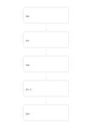

# 縦の五段階フロー

`flow-five-vertical` · `flow` · `a5-draft`

[繁體中文](README.zh-TW.md) · [English](README.en.md) · [日本語](README.ja.md) · [一覧へ戻る](../../docs/ja/catalog.md)

上から下へ五つの連続した段階を追い、つながりを確かめます。 図形の変更： 縦の段階数: 5.

## 向いている場面

**図形の対応:** `parameter` · [flow-four-horizontal](../flow-four-horizontal/README.ja.md)

- 受付・記録・割当・対応・返信の五手順を上から並べるとき。
- 五段階の引継ぎを縦に描き、次の段階が受け取るものを各枠に書くとき。

## 使い方

1. 上から五つの手順または問いを記し、矢印で隣の枠につなぎます。
2. 記入例を参考に、領域の順で記します：1「検索」；2「探す」；3「登録」；4「借りる」；5「返却」
3. 各領域を読み返し、未確認の点と次の行動を記します。

## 記入後に見えること

矢印に沿って順序、分岐、循環を追えます。

## 記入例

図の記入位置の順に示します。番号一つが一つの記入例です：

1. 検索
2. 探す
3. 登録
4. 借りる
5. 返却

[SVG](examples/ja.svg)

## 向いていない場面

分岐、循環、複数の担当者は一本道では十分に表せません。 小さなマスは短い語句向けで、長い文章には向きません。

## ダウンロード

- [文字なしSVG](exports/a5-draft/blank.svg)
- [文字なしPDF](exports/a5-draft/blank.pdf)
- [左上に英語名があるPDF](exports/a5-draft/titled.pdf)
- [濃い線の文字なしPDF](exports/a5-contrast/blank.pdf)
- [濃い線のSVG](exports/a5-contrast/blank.svg)

英語名は表題付きPDFだけに印刷され、文字なし版は自由な記入に使えます。

用紙サイズ：A5（148 × 210 mm）。設定ファイル：`a5-draft`。

## 由来と状態

一般的な幾何構造 · 詳しい由来の記録： [manifest.json](manifest.json)  
[MITライセンスの範囲](../../LICENSE-SCOPE.md)

[三言語の用語集](../../docs/ja/glossary.md)

## 変更と再生成

図形は `src/noteformats/variants.py`、文章は `src/noteformats/variant_content.py` を変更し、プロジェクトのルートで実行します：

`python scripts/build.py --ids flow-five-vertical`
