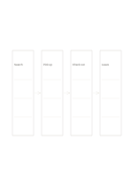

# Four-step horizontal flow

`flow-four-horizontal` · `flow` · `a5-draft`

[繁體中文](README.zh-TW.md) · [English](README.en.md) · [日本語](README.ja.md) · [Back to catalog](../../docs/en/catalog.md)

Show one process as four actions from left to right.

## When to use it

- Explain the main steps of borrowing a book.
- Check the order of preparation for a short event.

## How to use it

1. Name the start and the desired end.
2. Fill the two middle boxes so the arrows reflect actual order.
3. Read the sequence once to find a missing necessary step.

## What the page helps you see

A sequence, branch, or loop that can be traced along its arrows.

## Worked example

A fictional library loan moves through search, pickup, checkout, and departure.

[SVG](examples/en.svg)

## When not to use it

A single path cannot fully describe branching, loops, or several responsible roles.

## Downloads

- [Wordless SVG](exports/a5-draft/blank.svg)
- [Wordless PDF](exports/a5-draft/blank.pdf)
- [PDF with English name at top left](exports/a5-draft/titled.pdf)
- [Darker-ink wordless PDF](exports/a5-contrast/blank.pdf)
- [Darker-ink SVG](exports/a5-contrast/blank.svg)

The English name appears only on the titled PDF; the wordless version remains available for free writing.

Page size: A5 (148 × 210 mm); profile: `a5-draft`.

## Provenance and status

Generic geometry · Detailed source record: [manifest.json](manifest.json)  
[MIT license scope](../../LICENSE-SCOPE.md)

[Trilingual glossary](../../docs/en/glossary.md)

## Modify and rebuild

Change `profiles/a5-draft.json` or the corresponding builder in `src/noteformats/layouts/`, then run from the project root:

`python scripts/build.py --ids flow-four-horizontal`
