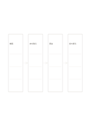

# 四段階の横向きフロー

`flow-four-horizontal` · `flow` · `a5-draft`

[繁體中文](README.zh-TW.md) · [English](README.en.md) · [日本語](README.ja.md) · [一覧へ戻る](../../docs/ja/catalog.md)

一つの作業を左から右へ四つの動作で示します。

## 向いている場面

- 本を借りる主な手順を説明するとき。
- 短い催しの準備順序を確かめるとき。

## 使い方

1. 始まりと終わりを決めます。
2. 途中の二段階を枠に入れ、矢印が実際の順序を示すようにします。
3. 通して読み、必要な手順が抜けていないか確かめます。

## 記入後に見えること

矢印に沿って順序、分岐、循環を追えます。

## 記入例

架空の図書館で検索、取り出し、貸出手続き、持ち帰りを並べています。

[SVG](examples/ja.svg)

## 向いていない場面

分岐、循環、複数の担当者は一本道では十分に表せません。

## ダウンロード

- [文字なしSVG](exports/a5-draft/blank.svg)
- [文字なしPDF](exports/a5-draft/blank.pdf)
- [左上に英語名があるPDF](exports/a5-draft/titled.pdf)
- [濃い線の文字なしPDF](exports/a5-contrast/blank.pdf)
- [濃い線のSVG](exports/a5-contrast/blank.svg)

英語名は表題付きPDFだけに印刷され、文字なし版は自由な記入に使えます。

用紙サイズ：A5（148 × 210 mm）。設定ファイル：`a5-draft`。

## 由来と状態

一般的な幾何構造 · 詳しい由来の記録： [manifest.json](manifest.json)  
[MITライセンスの範囲](../../LICENSE-SCOPE.md)

[三言語の用語集](../../docs/ja/glossary.md)

## 変更と再生成

`profiles/a5-draft.json` または `src/noteformats/layouts/` の描画関数を変更し、プロジェクトのルートで実行します：

`python scripts/build.py --ids flow-four-horizontal`
