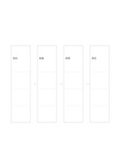

# 四步橫向流程

`flow-four-horizontal` · `flow` · `a5-draft`

[繁體中文](README.zh-TW.md) · [English](README.en.md) · [日本語](README.ja.md) · [返回目錄](../../docs/zh-TW/catalog.md)

把一件事寫成從左到右的四個連續動作。

## 適合情境

- 說明借書的主要步驟。
- 檢查簡短活動的準備順序。

## 使用步驟

1. 先寫出起點與終點。
2. 把中間兩步填入方框，讓箭頭代表實際先後。
3. 通讀一次，確認是否有跳過的必要步驟。

## 整理後可得到

沿箭頭追查步驟、分岔或循環的先後關係。

## 實際填寫示例

示例用虛構圖書館借書流程：查找、取書、辦理、帶走。

[SVG](examples/zh-TW.svg)

## 不適合情境

分岔、回圈或多角色責任無法由單一路徑充分表示。

## 下載

- [無字 SVG](exports/a5-draft/blank.svg)
- [無字 PDF](exports/a5-draft/blank.pdf)
- [左上角英文名稱 PDF](exports/a5-draft/titled.pdf)
- [深色墨線無字 PDF](exports/a5-contrast/blank.pdf)
- [深色墨線 SVG](exports/a5-contrast/blank.svg)

英文名稱只印在標題版 PDF；無字版仍適合自由列印與改作。

頁面尺寸：A5（148 × 210 mm）；設定檔：`a5-draft`。

## 來源與狀態

通用幾何結構 · 詳細來源紀錄見 [manifest.json](manifest.json)  
[MIT 授權範圍](../../LICENSE-SCOPE.md)

[三語術語表](../../docs/zh-TW/glossary.md)

## 修改與重新生成

修改 `profiles/a5-draft.json` 或 `src/noteformats/layouts/` 內對應的繪圖函式，再於專案根目錄執行：

`python scripts/build.py --ids flow-four-horizontal`
