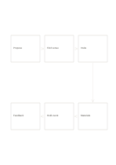

# Six-step snake flow

`flow-six-snake` · `flow` · `a5-draft`

[繁體中文](README.zh-TW.md) · [English](README.en.md) · [日本語](README.ja.md) · [Back to catalog](../../docs/en/catalog.md)

Follow six steps across two rows with a turn at the right edge.

## When to use it

- Describe six stages of event preparation.
- Map a service from application through feedback.

## How to use it

1. Write the first three steps left to right across the top.
2. Follow the right-hand downward arrow and write the last three right to left below.
3. Check the turn and endpoint so readers see one path, not two independent rows.

## What the page helps you see

A sequence, branch, or loop that can be traced along its arrows.

## Worked example

A fictional community workshop moves from idea and venue to invitation, materials, event, and feedback.

[SVG](examples/en.svg)

## When not to use it

Branching or parallel work is obscured by a single snake path.

## Downloads

- [Wordless SVG](exports/a5-draft/blank.svg)
- [Wordless PDF](exports/a5-draft/blank.pdf)
- [PDF with English name at top left](exports/a5-draft/titled.pdf)
- [Darker-ink wordless PDF](exports/a5-contrast/blank.pdf)
- [Darker-ink SVG](exports/a5-contrast/blank.svg)

The English name appears only on the titled PDF; the wordless version remains available for free writing.

Page size: A5 (148 × 210 mm); profile: `a5-draft`.

## Provenance and status

Original layout · Detailed source record: [manifest.json](manifest.json)  
[MIT license scope](../../LICENSE-SCOPE.md)

[Trilingual glossary](../../docs/en/glossary.md)

## Modify and rebuild

Change `profiles/a5-draft.json` or the corresponding builder in `src/noteformats/layouts/`, then run from the project root:

`python scripts/build.py --ids flow-six-snake`
