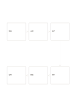

# 六段階の折返しフロー

`flow-six-snake` · `flow` · `a5-draft`

[繁體中文](README.zh-TW.md) · [English](README.en.md) · [日本語](README.ja.md) · [一覧へ戻る](../../docs/ja/catalog.md)

上段から右で折り返す二段六節点で連続した過程を示します。

## 向いている場面

- 六段階の催しの準備を説明するとき。
- 申込から感想までのサービスの一巡を描くとき。

## 使い方

1. 上段を左から右へ三段階書きます。
2. 右の下向き矢印に従い、下段を右から左へ三段階書きます。
3. 折返しと終点を確認し、二本の独立した流れと誤解されないようにします。

## 記入後に見えること

矢印に沿って順序、分岐、循環を追えます。

## 記入例

架空の地域ワークショップで発案、会場、案内、材料、開催、感想を順に示します。

[SVG](examples/ja.svg)

## 向いていない場面

分岐や並行作業を一つの蛇行線にすると本当の依存関係が隠れます。

## ダウンロード

- [文字なしSVG](exports/a5-draft/blank.svg)
- [文字なしPDF](exports/a5-draft/blank.pdf)
- [左上に英語名があるPDF](exports/a5-draft/titled.pdf)
- [濃い線の文字なしPDF](exports/a5-contrast/blank.pdf)
- [濃い線のSVG](exports/a5-contrast/blank.svg)

英語名は表題付きPDFだけに印刷され、文字なし版は自由な記入に使えます。

用紙サイズ：A5（148 × 210 mm）。設定ファイル：`a5-draft`。

## 由来と状態

本プロジェクトの独自レイアウト · 詳しい由来の記録： [manifest.json](manifest.json)  
[MITライセンスの範囲](../../LICENSE-SCOPE.md)

[三言語の用語集](../../docs/ja/glossary.md)

## 変更と再生成

`profiles/a5-draft.json` または `src/noteformats/layouts/` の描画関数を変更し、プロジェクトのルートで実行します：

`python scripts/build.py --ids flow-six-snake`
