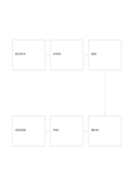

# 六步折返流程

`flow-six-snake` · `flow` · `a5-draft`

[繁體中文](README.zh-TW.md) · [English](README.en.md) · [日本語](README.ja.md) · [返回目錄](../../docs/zh-TW/catalog.md)

用上下兩排六個節點表示在頁面右側折返的連續過程。

## 適合情境

- 描述有六個階段的活動準備。
- 畫出服務流程中從申請到回饋的完整一輪。

## 使用步驟

1. 先沿上排由左到右寫前三步。
2. 循右側箭頭下移，沿下排由右到左寫後三步。
3. 檢查折返處與最後一步是否清楚，不要把閱讀順序誤作兩條流程。

## 整理後可得到

沿箭頭追查步驟、分岔或循環的先後關係。

## 實際填寫示例

示例是虛構社區工作坊：提出想法、找場地、邀請、準備材料、舉辦、收集回饋。

[SVG](examples/zh-TW.svg)

## 不適合情境

有分岔或並行工作時，蛇形單一路徑會隱藏真實依賴。

## 下載

- [無字 SVG](exports/a5-draft/blank.svg)
- [無字 PDF](exports/a5-draft/blank.pdf)
- [左上角英文名稱 PDF](exports/a5-draft/titled.pdf)
- [深色墨線無字 PDF](exports/a5-contrast/blank.pdf)
- [深色墨線 SVG](exports/a5-contrast/blank.svg)

英文名稱只印在標題版 PDF；無字版仍適合自由列印與改作。

頁面尺寸：A5（148 × 210 mm）；設定檔：`a5-draft`。

## 來源與狀態

本專案原創版面 · 詳細來源紀錄見 [manifest.json](manifest.json)  
[MIT 授權範圍](../../LICENSE-SCOPE.md)

[三語術語表](../../docs/zh-TW/glossary.md)

## 修改與重新生成

修改 `profiles/a5-draft.json` 或 `src/noteformats/layouts/` 內對應的繪圖函式，再於專案根目錄執行：

`python scripts/build.py --ids flow-six-snake`
