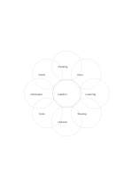

# Eight-petal idea flower

`flower-eight` · `mandala` · `a5-draft`

[繁體中文](README.zh-TW.md) · [English](README.en.md) · [日本語](README.ja.md) · [Back to catalog](../../docs/en/catalog.md)

Collect short ideas around one central topic in eight circular petals.

## When to use it

- Brainstorm eight traits for a story character.
- Explore different ways to join an event.

## How to use it

1. Name one central topic.
2. Put one short word in each petal and avoid early repetition.
3. Review neighboring petals for ideas worth combining.

## What the page helps you see

Several directions to explore from a central topic.

## Worked example

A fictional community garden branches into planting, rest, learning, sharing, upkeep, tools, rainwater, and paths.

[SVG](examples/en.svg)

## When not to use it

Overlapping petals do not represent mathematical set intersections; use a matrix for exact classification.

## Downloads

- [Wordless SVG](exports/a5-draft/blank.svg)
- [Wordless PDF](exports/a5-draft/blank.pdf)
- [PDF with English name at top left](exports/a5-draft/titled.pdf)
- [Darker-ink wordless PDF](exports/a5-contrast/blank.pdf)
- [Darker-ink SVG](exports/a5-contrast/blank.svg)

The English name appears only on the titled PDF; the wordless version remains available for free writing.

Page size: A5 (148 × 210 mm); profile: `a5-draft`.

## Provenance and status

Original layout · Detailed source record: [manifest.json](manifest.json)  
[MIT license scope](../../LICENSE-SCOPE.md)

[Trilingual glossary](../../docs/en/glossary.md)

## Modify and rebuild

Change `profiles/a5-draft.json` or the corresponding builder in `src/noteformats/layouts/`, then run from the project root:

`python scripts/build.py --ids flower-eight`
