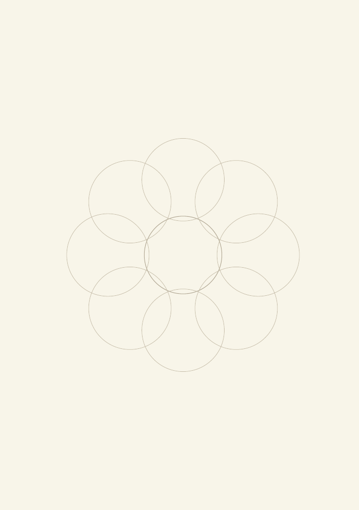

# 八枚花びらの発想図

`flower-eight` · `mandala` · `a5-draft`

[繁體中文](README.zh-TW.md) · [English](README.en.md) · [日本語](README.ja.md) · [一覧へ戻る](../../docs/ja/catalog.md)

中心の主題を囲む八つの丸い花びらに短い考えを集めます。

## 向いている場面

- 物語の人物の性格を八つの手がかりから考えるとき。
- 催しへの参加方法を幅広く探るとき。

## 使い方

1. 中央に一つの主題を書きます。
2. 各花びらに短い語を一つ書き、最初は重複を避けます。
3. 隣の花びらを見直し、組み合わせたい案に印を付けます。

## 記入後に見えること

中心のテーマから次に調べる方向を広げられます。

## 記入例

架空の地域菜園から栽培、休憩、学習、共有、維持、道具、雨水、通路へ広げます。

[SVG](examples/ja.svg)

## 向いていない場面

重なりは集合の交差を示しません。正確な分類には表やマトリクスを使います。

## ダウンロード

- [文字なしSVG](exports/a5-draft/blank.svg)
- [文字なしPDF](exports/a5-draft/blank.pdf)
- [左上に英語名があるPDF](exports/a5-draft/titled.pdf)
- [濃い線の文字なしPDF](exports/a5-contrast/blank.pdf)
- [濃い線のSVG](exports/a5-contrast/blank.svg)

英語名は表題付きPDFだけに印刷され、文字なし版は自由な記入に使えます。

用紙サイズ：A5（148 × 210 mm）。設定ファイル：`a5-draft`。

## 由来と状態

本プロジェクトの独自レイアウト · 詳しい由来の記録： [manifest.json](manifest.json)  
[MITライセンスの範囲](../../LICENSE-SCOPE.md)

[三言語の用語集](../../docs/ja/glossary.md)

## 変更と再生成

`profiles/a5-draft.json` または `src/noteformats/layouts/` の描画関数を変更し、プロジェクトのルートで実行します：

`python scripts/build.py --ids flower-eight`
