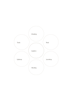

# Six-petal idea flower

`flower-six` · `mandala` · `a5-draft`

[繁體中文](README.zh-TW.md) · [English](README.en.md) · [日本語](README.ja.md) · [Back to catalog](../../docs/en/catalog.md)

Expand one central topic into six distinct surrounding idea bubbles. Geometry change: outer bubbles: 6.

## When to use it

**Geometry relationship:** `parameter` · [flower-eight](../flower-eight/README.en.md)

- Explore six facets of a story character's motives, habits or background around a central name.
- Place a community event in the center and identify six distinct participation needs on its petals.

## How to use it

1. Put the topic in the center and a distinct facet in each outer circle.
2. Use the worked example to place entries in region order: 1: "Garden"; 2: "Planting"; 3: "Rest"; 4: "Learning"; 5: "Sharing"; 6: "Upkeep"; 7: "Tools"
3. Review the regions, mark open questions and choose a next step.

## What the page helps you see

Several directions to explore from a central topic.

## Worked example

Entries in example-position order; each number identifies one entry:

1. Garden
2. Planting
3. Rest
4. Learning
5. Sharing
6. Upkeep
7. Tools

[SVG](examples/en.svg)

## When not to use it

The six petals expand facets, while their overlapping outlines imply neither set intersections nor causation; use a matrix or concept network for explicit membership rules and relations.

## Downloads

- [Wordless SVG](exports/a5-draft/blank.svg)
- [Wordless PDF](exports/a5-draft/blank.pdf)
- [PDF with English name at top left](exports/a5-draft/titled.pdf)
- [Darker-ink wordless PDF](exports/a5-contrast/blank.pdf)
- [Darker-ink SVG](exports/a5-contrast/blank.svg)

The English name appears only on the titled PDF; the wordless version remains available for free writing.

Page size: A5 (148 × 210 mm); profile: `a5-draft`.

## Provenance and status

Original layout · Detailed source record: [manifest.json](manifest.json)  
[MIT license scope](../../LICENSE-SCOPE.md)

[Trilingual glossary](../../docs/en/glossary.md)

## Modify and rebuild

Edit geometry in `src/noteformats/variants.py` or text in `src/noteformats/variant_content.py`, then run from the project root:

`python scripts/build.py --ids flower-six`
