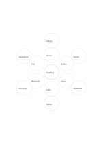

# Two-ring idea flower

`flower-two-rings` · `mandala` · `a5-draft`

[繁體中文](README.zh-TW.md) · [English](README.en.md) · [日本語](README.ja.md) · [Back to catalog](../../docs/en/catalog.md)

Write six main directions in the inner ring and one concrete detail for each in the outer ring.

## When to use it

- List six event needs and then one action for each.
- Give each of six research aspects one example to check.

## How to use it

1. Put the core question in the center.
2. Write broad aspects on the six inner petals and matching details outside.
3. Check that each outer word truly belongs to its inner aspect.

## What the page helps you see

Several directions to explore from a central topic.

## Worked example

A fictional reading group has venue, books, time, invitation, materials, and discussion inside, each with one example outside.

[SVG](examples/en.svg)

## When not to use it

Each bubble fits a short word; aspects needing several details deserve their own page.

## Downloads

- [Wordless SVG](exports/a5-draft/blank.svg)
- [Wordless PDF](exports/a5-draft/blank.pdf)
- [PDF with English name at top left](exports/a5-draft/titled.pdf)
- [Darker-ink wordless PDF](exports/a5-contrast/blank.pdf)
- [Darker-ink SVG](exports/a5-contrast/blank.svg)

The English name appears only on the titled PDF; the wordless version remains available for free writing.

Page size: A5 (148 × 210 mm); profile: `a5-draft`.

## Provenance and status

Original layout · Detailed source record: [manifest.json](manifest.json)  
[MIT license scope](../../LICENSE-SCOPE.md)

[Trilingual glossary](../../docs/en/glossary.md)

## Modify and rebuild

Change `profiles/a5-draft.json` or the corresponding builder in `src/noteformats/layouts/`, then run from the project root:

`python scripts/build.py --ids flower-two-rings`
