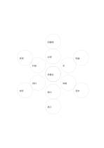

# 二重の発想花

`flower-two-rings` · `mandala` · `a5-draft`

[繁體中文](README.zh-TW.md) · [English](README.en.md) · [日本語](README.ja.md) · [一覧へ戻る](../../docs/ja/catalog.md)

内側に六つの大きな方向、外側に対応する具体例を一つずつ置きます。

## 向いている場面

- 催しの六つの必要事項を列挙し、行動を補うとき。
- 研究を六面に分け、それぞれ調べる例を置くとき。

## 使い方

1. 中央に核となる問いを書きます。
2. 内側の六つに大きな観点、外側に対応する細部を書きます。
3. 外の語が内の観点に本当に属するか確かめます。

## 記入後に見えること

中心のテーマから次に調べる方向を広げられます。

## 記入例

架空の読書会を中心に、会場、本、時間、案内、資料、討論を内側に、各一例を外側に置きます。

[SVG](examples/ja.svg)

## 向いていない場面

泡は小さく短い語向けです。一つの方向に多くの細部が要るなら別のページを使います。

## ダウンロード

- [文字なしSVG](exports/a5-draft/blank.svg)
- [文字なしPDF](exports/a5-draft/blank.pdf)
- [左上に英語名があるPDF](exports/a5-draft/titled.pdf)
- [濃い線の文字なしPDF](exports/a5-contrast/blank.pdf)
- [濃い線のSVG](exports/a5-contrast/blank.svg)

英語名は表題付きPDFだけに印刷され、文字なし版は自由な記入に使えます。

用紙サイズ：A5（148 × 210 mm）。設定ファイル：`a5-draft`。

## 由来と状態

本プロジェクトの独自レイアウト · 詳しい由来の記録： [manifest.json](manifest.json)  
[MITライセンスの範囲](../../LICENSE-SCOPE.md)

[三言語の用語集](../../docs/ja/glossary.md)

## 変更と再生成

`profiles/a5-draft.json` または `src/noteformats/layouts/` の描画関数を変更し、プロジェクトのルートで実行します：

`python scripts/build.py --ids flower-two-rings`
