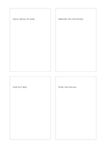

# Four separate cards

`four-cards` · `cards` · `a5-draft`

[繁體中文](README.zh-TW.md) · [English](README.en.md) · [日本語](README.ja.md) · [Back to catalog](../../docs/en/catalog.md)

Give four small topics independent bordered areas with visible gaps between them.

## When to use it

- Prepare one brief for each of four workshop questions.
- Record four concepts that do not depend on one another after reading.

## How to use it

1. Give each card a short topic.
2. Add related phrases or a small sketch inside without forcing row alignment.
3. Review the order and check whether any cards should be combined.

## What the page helps you see

Separate units that can be reordered, compared, or selected.

## Worked example

A fictional neighborhood event separates venue, materials, invitations, and schedule into four cards.

[SVG](examples/en.svg)

## When not to use it

Use a quadrant for two crossing dimensions; separate cards do not imply axes.

## Downloads

- [Wordless SVG](exports/a5-draft/blank.svg)
- [Wordless PDF](exports/a5-draft/blank.pdf)
- [PDF with English name at top left](exports/a5-draft/titled.pdf)
- [Darker-ink wordless PDF](exports/a5-contrast/blank.pdf)
- [Darker-ink SVG](exports/a5-contrast/blank.svg)

The English name appears only on the titled PDF; the wordless version remains available for free writing.

Page size: A5 (148 × 210 mm); profile: `a5-draft`.

## Provenance and status

Generic geometry · Detailed source record: [manifest.json](manifest.json)  
[MIT license scope](../../LICENSE-SCOPE.md)

[Trilingual glossary](../../docs/en/glossary.md)

## Modify and rebuild

Change `profiles/a5-draft.json` or the corresponding builder in `src/noteformats/layouts/`, then run from the project root:

`python scripts/build.py --ids four-cards`
