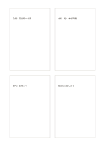

# 四枚の独立カード

`four-cards` · `cards` · `a5-draft`

[繁體中文](README.zh-TW.md) · [English](README.en.md) · [日本語](README.ja.md) · [一覧へ戻る](../../docs/ja/catalog.md)

四つの小さな主題を余白で離した枠に分けます。

## 向いている場面

- ワークショップの四つの話題を個別に準備するとき。
- 読書後に互いに独立した四概念を書くとき。

## 使い方

1. 各枠に短い主題を一つ置きます。
2. 関連する語句や小さな図を枠内に加え、無理に行をそろえません。
3. 読む順序を見直し、まとめた方がよい枠がないか確かめます。

## 記入後に見えること

項目を分けて、並べ替えや比較、選択ができます。

## 記入例

架空の地域活動について、会場、材料、案内、進行を四枚に分けています。

[SVG](examples/ja.svg)

## 向いていない場面

二つの観点が交差する分類には4象限を使います。独立カードに軸の意味はありません。

## ダウンロード

- [文字なしSVG](exports/a5-draft/blank.svg)
- [文字なしPDF](exports/a5-draft/blank.pdf)
- [左上に英語名があるPDF](exports/a5-draft/titled.pdf)
- [濃い線の文字なしPDF](exports/a5-contrast/blank.pdf)
- [濃い線のSVG](exports/a5-contrast/blank.svg)

英語名は表題付きPDFだけに印刷され、文字なし版は自由な記入に使えます。

用紙サイズ：A5（148 × 210 mm）。設定ファイル：`a5-draft`。

## 由来と状態

一般的な幾何構造 · 詳しい由来の記録： [manifest.json](manifest.json)  
[MITライセンスの範囲](../../LICENSE-SCOPE.md)

[三言語の用語集](../../docs/ja/glossary.md)

## 変更と再生成

`profiles/a5-draft.json` または `src/noteformats/layouts/` の描画関数を変更し、プロジェクトのルートで実行します：

`python scripts/build.py --ids four-cards`
