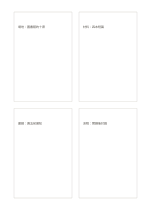

# 四張獨立卡

`four-cards` · `cards` · `a5-draft`

[繁體中文](README.zh-TW.md) · [English](README.en.md) · [日本語](README.ja.md) · [返回目錄](../../docs/zh-TW/catalog.md)

將四個小主題各放入有留白間隔的獨立區塊。

## 適合情境

- 工作坊前替四個討論題各備一張摘要。
- 閱讀後記錄四個互不依賴的概念。

## 使用步驟

1. 每卡先寫一個短題目。
2. 在卡內放相關短句或小圖，不必強行逐列對齊。
3. 完成後移動閱讀順序，檢查是否有內容應合併。

## 整理後可得到

把可移動的事項分開，方便排序、比較或選擇。

## 實際填寫示例

示例把虛構社區活動的場地、材料、邀請與流程分別放在四張卡。

[SVG](examples/zh-TW.svg)

## 不適合情境

需要兩軸交叉分類時應用四象限；四張卡沒有預設的軸關係。

## 下載

- [無字 SVG](exports/a5-draft/blank.svg)
- [無字 PDF](exports/a5-draft/blank.pdf)
- [左上角英文名稱 PDF](exports/a5-draft/titled.pdf)
- [深色墨線無字 PDF](exports/a5-contrast/blank.pdf)
- [深色墨線 SVG](exports/a5-contrast/blank.svg)

英文名稱只印在標題版 PDF；無字版仍適合自由列印與改作。

頁面尺寸：A5（148 × 210 mm）；設定檔：`a5-draft`。

## 來源與狀態

通用幾何結構 · 詳細來源紀錄見 [manifest.json](manifest.json)  
[MIT 授權範圍](../../LICENSE-SCOPE.md)

[三語術語表](../../docs/zh-TW/glossary.md)

## 修改與重新生成

修改 `profiles/a5-draft.json` 或 `src/noteformats/layouts/` 內對應的繪圖函式，再於專案根目錄執行：

`python scripts/build.py --ids four-cards`
