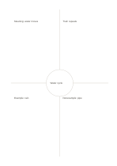

# Frayer concept map

`frayer` · `learning` · `a5-draft`

[繁體中文](README.zh-TW.md) · [English](README.en.md) · [日本語](README.ja.md) · [Back to catalog](../../docs/en/catalog.md)

Put a concept in the center, then separate meaning, traits, example, and nonexample.

## When to use it

**Geometry relationship:** `equivalent` · [quadrant-center-circle](../quadrant-center-circle/README.en.md)

- Study a concept such as the water cycle by surrounding its name with definition, characteristics, examples and nonexamples.
- Use examples and nonexamples to check the boundary between concepts that are easy to confuse.

## How to use it

1. Put the concept in the center and assign the four regions to definition, characteristics, examples and nonexamples.
2. Write the definition and characteristics in your own words, then add one qualifying case and one nonexample.
3. Explain why each case fits or does not fit and revise the definition if needed.

## What the page helps you see

Concepts, cues, and recalled answers that can be checked against one another.

## Worked example

Entries in example-position order; each number identifies one entry:

1. Water cycle
2. Meaning: water moves
3. Trait: repeats
4. Example: rain
5. Nonexample: pipe

[SVG](examples/en.svg)

## When not to use it

Examples and nonexamples depend on the chosen definition and context; filling all four regions does not establish understanding without reasons and boundary cases.

## Downloads

- [Wordless SVG](exports/a5-draft/blank.svg)
- [Wordless PDF](exports/a5-draft/blank.pdf)
- [PDF with English name at top left](exports/a5-draft/titled.pdf)
- [Darker-ink wordless PDF](exports/a5-contrast/blank.pdf)
- [Darker-ink SVG](exports/a5-contrast/blank.svg)

The English name appears only on the titled PDF; the wordless version remains available for free writing.

Page size: A5 (148 × 210 mm); profile: `a5-draft`.

## Provenance and status

Original layout · Detailed source record: [manifest.json](manifest.json)  
[MIT license scope](../../LICENSE-SCOPE.md)

[Trilingual glossary](../../docs/en/glossary.md)

## Modify and rebuild

Edit geometry in `src/noteformats/variants.py` or text in `src/noteformats/variant_content.py`, then run from the project root:

`python scripts/build.py --ids frayer`
