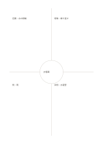

# フレイヤーの概念図

`frayer` · `learning` · `a5-draft`

[繁體中文](README.zh-TW.md) · [English](README.en.md) · [日本語](README.ja.md) · [一覧へ戻る](../../docs/ja/catalog.md)

中央の概念から定義、特徴、例、非例を分けます。

## 向いている場面

**図形の対応:** `equivalent` · [quadrant-center-circle](../quadrant-center-circle/README.ja.md)

- 水循環などの概念を中央に置き、周囲に定義・特徴・例・非例を整理するとき。
- 混同しやすい概念の境界を、例と非例で確かめるとき。

## 使い方

1. 中心に概念を書き、四領域を定義・特徴・例・非例に割り当てます。
2. 自分の言葉で定義と特徴を記し、当てはまる具体例と当てはまらない例を加えます。
3. 各例が該当する理由としない理由を説明し、必要なら定義を直します。

## 記入後に見えること

概念、手がかり、思い出した答えを照合できます。

## 記入例

図の記入位置の順に示します。番号一つが一つの記入例です：

1. 水循環
2. 定義：水の移動
3. 特徴：繰り返す
4. 例：雨
5. 非例：水道管

[SVG](examples/ja.svg)

## 向いていない場面

例と非例は採用した定義や文脈に依存します。四領域を埋めるだけで理解が確かになるわけではなく、分類理由と境界事例の検討が必要です。

## ダウンロード

- [文字なしSVG](exports/a5-draft/blank.svg)
- [文字なしPDF](exports/a5-draft/blank.pdf)
- [左上に英語名があるPDF](exports/a5-draft/titled.pdf)
- [濃い線の文字なしPDF](exports/a5-contrast/blank.pdf)
- [濃い線のSVG](exports/a5-contrast/blank.svg)

英語名は表題付きPDFだけに印刷され、文字なし版は自由な記入に使えます。

用紙サイズ：A5（148 × 210 mm）。設定ファイル：`a5-draft`。

## 由来と状態

本プロジェクトの独自レイアウト · 詳しい由来の記録： [manifest.json](manifest.json)  
[MITライセンスの範囲](../../LICENSE-SCOPE.md)

[三言語の用語集](../../docs/ja/glossary.md)

## 変更と再生成

図形は `src/noteformats/variants.py`、文章は `src/noteformats/variant_content.py` を変更し、プロジェクトのルートで実行します：

`python scripts/build.py --ids frayer`
