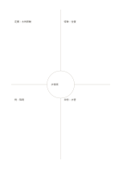

# Frayer 概念四分圖

`frayer` · `learning` · `a5-draft`

[繁體中文](README.zh-TW.md) · [English](README.en.md) · [日本語](README.ja.md) · [返回目錄](../../docs/zh-TW/catalog.md)

中央寫概念，四區分開定義、特徵、例子與非例。

## 適合情境

**幾何對照:** `equivalent` · [quadrant-center-circle](../quadrant-center-circle/README.zh-TW.md)

- 學習水循環等概念時，在中央寫概念，四周分別整理定義、特徵、例子與非例。
- 發現相近概念容易混淆時，用例子與非例檢查分類邊界。

## 使用步驟

1. 中央寫要學習的概念，周圍四區分別指定為定義、特徵、例子與非例。
2. 用自己的話寫定義與特徵，再加入一個符合與一個不符合定義的具體案例。
3. 逐一說明案例為何屬於或不屬於這個概念，必要時回頭修訂定義。

## 整理後可得到

把概念、線索與回想結果相互對照。

## 實際填寫示例

依圖中填寫位置順序列出，每個編號是一筆示例條目：

1. 水循環
2. 定義：水的移動
3. 特徵：往復
4. 例：降雨
5. 非例：水管

[SVG](examples/zh-TW.svg)

## 不適合情境

例子與非例是否成立取決於採用的定義與脈絡；四區填滿不代表概念已理解，仍應說明分類理由並檢查邊界案例。

## 下載

- [無字 SVG](exports/a5-draft/blank.svg)
- [無字 PDF](exports/a5-draft/blank.pdf)
- [左上角英文名稱 PDF](exports/a5-draft/titled.pdf)
- [深色墨線無字 PDF](exports/a5-contrast/blank.pdf)
- [深色墨線 SVG](exports/a5-contrast/blank.svg)

英文名稱只印在標題版 PDF；無字版仍適合自由列印與改作。

頁面尺寸：A5（148 × 210 mm）；設定檔：`a5-draft`。

## 來源與狀態

本專案原創版面 · 詳細來源紀錄見 [manifest.json](manifest.json)  
[MIT 授權範圍](../../LICENSE-SCOPE.md)

[三語術語表](../../docs/zh-TW/glossary.md)

## 修改與重新生成

調整 `src/noteformats/variants.py` 的幾何或 `src/noteformats/variant_content.py` 的文字，再於專案根目錄執行：

`python scripts/build.py --ids frayer`
