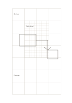

# Overview and detail grid

`grid-hierarchical` · `grid-dot` · `a5-draft`

[繁體中文](README.zh-TW.md) · [English](README.en.md) · [日本語](README.ja.md) · [Back to catalog](../../docs/en/catalog.md)

Use large cells for the whole plan and a localized finer grid for one important area.

## When to use it

- Block out a room, then detail one worktable in the center.
- Plan a display board before refining its key panel.

## How to use it

1. Assign the main regions using the coarse outer cells.
2. Use the center fine grid for one enlarged detail without confusing the two scales.
3. Note what a large and a small cell each represents.

## What the page helps you see

Aligned objects, counts, or spatial positions on the grid or dots.

## Worked example

A fictional reading corner is divided into seating, shelves, and passage; the center grid expands the tabletop arrangement.

[SVG](examples/en.svg)

## When not to use it

A local detail zone biases the page when every region needs equal detail. Precise drafting still requires stated measurements.

## Downloads

- [Wordless SVG](exports/a5-draft/blank.svg)
- [Wordless PDF](exports/a5-draft/blank.pdf)
- [PDF with English name at top left](exports/a5-draft/titled.pdf)
- [Darker-ink wordless PDF](exports/a5-contrast/blank.pdf)
- [Darker-ink SVG](exports/a5-contrast/blank.svg)

The English name appears only on the titled PDF; the wordless version remains available for free writing.

Page size: A5 (148 × 210 mm); profile: `a5-draft`.

## Provenance and status

Original layout · Detailed source record: [manifest.json](manifest.json)  
[MIT license scope](../../LICENSE-SCOPE.md)

[Trilingual glossary](../../docs/en/glossary.md)

## Modify and rebuild

Change `profiles/a5-draft.json` or the corresponding builder in `src/noteformats/layouts/`, then run from the project root:

`python scripts/build.py --ids grid-hierarchical`
